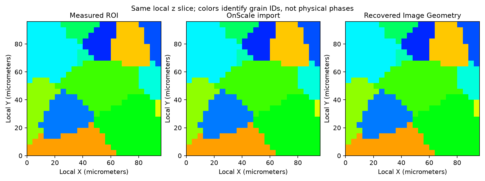

# Gille OnScale Import and Uniform Grid

- Executable pipeline: `(03) Gille OnScale Import and Uniform Grid.d3dpipeline`
- Source Material: [Gille et al. (2024), *3D strain heterogeneity and fracture studied by X-ray tomography and crystal plasticity in an aluminium alloy*](https://doi.org/10.1016/j.ijplas.2024.104146) (source data and scientific context; this is an additional format-conversion illustration).
- Input Data: `Data/Output/Gille_Aluminum_LabDCT_Examples/OnScale/Export/GilleROI24.flxtbl`, created by [OnScale Export](%2802%29%20Gille%20OnScale%20Export.md) from the [public dataset](https://doi.org/10.18126/yc1m-nk41); keep datasets and generated results outside this repository.

> **Before adapting:** Do not treat this example as a validated acceptance procedure. Adapt and validate it for the scanner, material, resolution, and quality requirement. Run stage 02 before preflighting this pipeline. The reader assigns metres, and positive cell ID `k` refers to imported material-name row `k - 1`. Preserving labels on this unchanged grid does not establish accuracy for coarser or nonuniform resampling.

## At a glance

| Item | What to expect |
| --- | --- |
| Question | Can I recover the exported grain map and convert its rectilinear representation to a uniform NX image grid? |
| Prerequisite | Stage 02 has written `GilleROI24.flxtbl`; see [setup and run](README.md). |
| Imported grid | `ImportedOnScale_m`, a **24 × 24 × 24 Rectilinear Grid** with 25 bounds on each axis |
| Recovered grid | `RecoveredImage_m`, a **24 × 24 × 24 Image Geometry**, approximately **0.000004 m** spacing and origin **[0,0,0]** |
| Population | **13,824 cells**, **37 observed grain IDs**, range **623–935 with gaps** |
| Result | `Data/Output/Gille_Aluminum_LabDCT_Examples/OnScale/Import/GilleROI24_RoundTrip.dream3d` |
| Scope | Coordinate and categorical-label round trip; no solver execution or new microstructure inference |

## Purpose and real-world setting

Simulation and instrument formats often use explicit coordinate bounds. Many NX workflows consume an Image Geometry described by origin, uniform spacing and dimensions. This example shows that transition with a measured aluminium grain map whose expected labels and geometry are available from stage 02.

The Gille LabDCT data provide the measured context. This additional conversion example does not reproduce the paper's deformation or fracture results. Reading an OnScale table does not demonstrate successful solver execution: the input contains labels and names, without orientations, calibrated material properties or loading history.

## Data flow and choices

| Stage | Motivation, alternatives and pitfalls |
| --- | --- |
| Read OnScale Table File | Create `ImportedOnScale_m` from `xcrd`, `ycrd`, `zcrd` and `matr`. Explicit bounds naturally form a Rectilinear Grid, even though this particular table is uniformly spaced. |
| Preserve names and labels | Keep `GrainId` values unchanged. Read material names in file order, with the first name at row 0. This changes the name-array indexing relative to the writer's input; it does not subtract one from the cell IDs. |
| Resample Rectilinear Grid to Image Geom | Select `GrainId` and dimensions **[24,24,24]**. The filter derives origin and spacing from the imported bounds and copies the units. Matching the original grid isolates the representation conversion. |
| Save both geometries | Retain the rectilinear input and `RecoveredImage_m` in one checkpoint so dimensions, bounds and labels can be compared. Use the separate export checkpoint to trace either result back to the measured ROI. |

Export and import are separate because the reader opens the table during preflight to determine dimensions and name count. A writer earlier in the same pipeline cannot supply that file during initial preflight. Follow the order **01 preparation → 02 export → 03 import**.

The reader derives dimensions from coordinate counts, ignores `divisions` and `keypoints`, and assigns metres. All three coordinate sections are present, so fallback settings for missing axes are unused. Stage 02 already converted the coordinate numbers to metres.

## Outputs and interpretation

The preview uses matching categorical colours for matching grain IDs, independent of orientations or phases. A matching slice aids inspection; full-volume label equality is the stronger check.

| Check | Expected result and meaning |
| --- | --- |
| Rectilinear geometry | Each of `X Bounds`, `Y Bounds` and `Z Bounds` has **25 entries**, increasing from **0 to approximately 0.000096 m**. There are 24 cells between those faces on each axis. |
| Image Geometry | Origin **[0,0,0]**, dimensions **[24,24,24]**, metre units, and approximately **0.000004 m** spacing. Its outer extents agree with the imported bounds. |
| Grain labels | `ImportedOnScale_m/Cell Data/GrainId` and `RecoveredImage_m/Cell Data/GrainId` equal the stage-02 `OnScaleROI_m/Cell Data/GrainId` array cell for cell. All retain 37 active IDs and 13,824 cells. |
| Material names | **935 rows** represent file slots for IDs 1–935. Row **0** is `Aluminum`; row **622** is `Phase_623`; row **934** is `Phase_935`. Only 37 IDs occur in cells. |

To look up a name, use **`Material Names[GrainId - 1]`** for a positive ID. The original writer indexed its input names by `GrainId` and omitted tuple 0. Do not apply the original indexing convention to this imported array. The inactive `Aluminum` entry at row 0 does not imply that grain ID 0 is aluminium, and `Phase_623` does not indicate a newly discovered physical phase.

Compare integer labels exactly. Compare floating-point spacing and bounds with a small tolerance. Both geometries remain in the local ROI frame; restore measured placement using the `MeasuredROI_mm` origin and mapping in the stage-02 companion.

## Adapting the example

The current resampler locates each destination voxel centre in the source rectilinear bounds and copies that cell's categorical value. It does not average labels, compute majority occupancy or conserve each grain's volume. At the same dimensions and spacing used here, the centres fall inside their corresponding original cells. On a coarser or nonuniform grid, small grains can disappear and measured volumes can change; evaluate those effects separately before using the result for science or simulation.

Keep positive target dimensions and inspect coordinate monotonicity, extents and units. Higher resolution adds samples of existing labels without new measured detail. Additional continuous fields may need an interpolation method appropriate to their meaning.

This table does not carry the original Euler angles, completeness or IPF arrays. Recover those from the native preparation or retained measured ROI only after establishing the cell or grain correspondence. Solver configuration, material-axis assignment, actual OnScale execution and Avizo runtime compatibility remain unverified. Retain the [CC BY 4.0 attribution](SourceDataLicense.md) with derived results.
