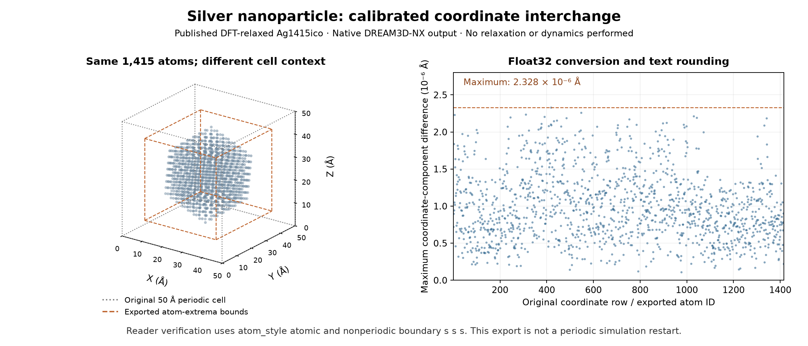

# Silver Nanoparticle Coordinate Interchange

Executable pipeline: `(01) Silver Nanoparticle Coordinate Interchange.d3dpipeline`

Source material: Tarrat and Loffreda (2026), [The Fierce Morphological Battle of Silver Nanoparticles: How Irregularities, Vacancies and Defects Tip the Crossing Sizes](https://doi.org/10.1002/smll.75018), *Small* 22(56), e75018.

Input data: [Original Ag1415ico CONTCAR](https://nomad-lab.eu/prod/v1/api/v1/uploads/zwh0pQTnT3ek9K4HVAED3Q/raw/SILVER_NANOPARTICLES_DATABASE/ICOSAHEDRA/MACKAY/Ag1415ico/CONTCAR), saved unchanged as `Data/NOMAD_Silver_Nanoparticle/Ag1415ico.CONTCAR`. Follow the [download, checksum, and attribution instructions](README.md#source-data-and-license).

> **Before adapting:** This import uses a fixed CONTCAR table schema and cell transform. Verify the original checksum before running. The LAMMPS output transfers finite atom coordinates and types; it does not preserve a simulation cell or provide a complete simulation setup.

## At a glance

| Item | Meaning |
| --- | --- |
| Source | Complete Ag1415ico Mackay icosahedron: 1,415 Ag atoms |
| Data origin | Published DFT-relaxed coordinates; simulation-derived, not measured |
| Units | Fractional input; Cartesian output in Å |
| Workflow | Import → combine XYZ → scale → copy to vertices → assign types/row IDs → export |
| Outputs | LAMMPS coordinate/type text and a DREAM3D inspection checkpoint |
| Scientific scope | Illustrative interchange; no DFT, relaxation, energy ranking, or dynamics |

Use this workflow to inspect a published nanoparticle and check units, atom identity, and precision when transferring coordinates between tools.

## Input assumptions

The input belongs to [NOMAD dataset 10.17172/NOMAD/2026.03.23-1](https://doi.org/10.17172/NOMAD/2026.03.23-1), licensed CC BY 4.0. It has scale factor 1, diagonal 50 Å lattice vectors, one Ag species, `Selective dynamics`, and `Direct` coordinates. Nine header lines precede 1,415 six-column atom records: fractional X/Y/Z and T/T/T flags. A blank line and 1,415 zero-velocity rows follow.

The pipeline reads the original file directly. It retains the six atom columns and stops before the velocity block. It does not create an intermediate XYZ file, parse arbitrary CONTCAR headers, or import velocities. Keep the original input as the complete source record.

## Filters, settings, and reasons

| Step | Filter | Settings and rationale |
| --- | --- | --- |
| 1 | Create Data Group | Create `Source` for the original columns and coordinate copies. |
| 2 | Read CSV File | Start at row **10**; read **1415** tuples into `Source/Atoms`. Use three Float64 coordinate columns and three string flags. Space/tab delimiters with `Consecutive Delimiters=false` skip empty tokens between repeated spaces. The fixed count excludes velocities. |
| 3 | Combine Attribute Arrays | Combine `FractionalX`, `FractionalY`, `FractionalZ` in that order as `FractionalXYZ`. Disable normalization and source removal. |
| 4 | Array Calculator | Calculate `FractionalXYZ * 50` into `CartesianAngstrom64` as Float64. This is valid because the source cell is scale-1 and diagonal 50 Å. |
| 5 | Convert Data | Copy to `CartesianAngstrom32`. Vertex geometry requires Float32; retain the Float64 reference to assess rounding. |
| 6 | Create Geometry | Create Vertex (2), Angstrom (21), **Copy** (0), `Ag1415`, and `AtomData`. Preserve source arrays; treat geometry warnings as errors. |
| 7 | Create Data Array (Advanced) | Inherit 1,415 rows. Fill scalar Int32 `AtomType` with **1**, meaning Ag for this verified single-species source. |
| 8 | Create Data Array (Advanced) | Create Int32 `SourceRow1Based`: incremental addition starting at **1**, step **1**. Source file line = this value + 9. |
| 9 | Write LAMMPS File | Export the geometry with `AtomType`. Atom ID follows the original coordinate-row order; text coordinates have six decimal places and image flags are zero. |
| 10 | Write DREAM3D | Save the source columns, both coordinate precisions, geometry, types, and row identities; compression level 5, no XDMF. |

The executable pipeline is authoritative. No step crops, duplicates, pads, shifts, wraps, reorders, or relaxes atoms.

## Outputs and interpretation

Both files are under `Data/Output/NOMAD_Silver_Nanoparticle/`:

- `Ag1415ico_Interchange.dream3d`: inspect `Source/Atoms/FractionalXYZ`, `CartesianAngstrom64`, and `Ag1415/CartesianAngstrom32`. Geometry row zero is a real atom. `Ag1415/AtomData/SourceRow1Based` links each vertex to its original coordinate record.
- `Ag1415ico.lammps`: 1,415 atoms, one type, and fields `id type x y z ix iy iz`. Type **1** means Ag; it is not a grain or phase measurement. Row identifiers do not encode bonds or surface membership.

This original visualization uses the output coordinates. The source vacuum cell and the writer's coordinate-extrema box are different. The exported bounds are X `[7.615476, 43.212006]`, Y `[5.110205, 43.514324]`, and Z `[6.956580, 42.709080]` Å; they do not retain the original 0–50 Å cell.

| Coordinate comparison | Maximum absolute component difference (Å) |
| --- | ---: |
| Float64 versus independent source conversion | 0 |
| Float32 vertices versus original Cartesian coordinates | 1.9051 × 10⁻⁶ |
| Six-decimal text versus Float32 vertices | 4.9964 × 10⁻⁷ |
| Exported text versus original Cartesian coordinates | 2.3283 × 10⁻⁶ |

Use the Float64 checkpoint and original input for precision-sensitive work. For a read-only LAMMPS import, use `units metal`, `atom_style atomic`, and `boundary s s s` before `read_data`; see the [complete commands](README.md#read-the-export-in-lammps). Nonperiodic shrink-wrap boundaries let the reader adjust its box. Fixed bounds can reject upper-face atoms, while periodic boundaries can wrap them. Zero image flags supply no periodic-image history. Masses, potentials, velocities, constraints, and DFT settings/energies are absent.

## Adaptation pitfalls

- Recheck the header, row count, species ordering, and coordinate mode for another input. For a noncubic lattice, use its full lattice transform; multiplication by 50 is wrong.
- Compare coordinates by `SourceRow1Based` and retain geometry tuple zero, and check all types and flags. Preserve 1,415 finite, unique positions for this source.
- Derive another system's atom types from its actual species records. A constant type 1 is specific to this Ag configuration.
- The current writer crashes below 1,000 atoms ([issue 1818](https://github.com/BlueQuartzSoftware/simplnx/issues/1818)). Do not crop or manufacture additional atoms to bypass it.
- Use a fresh output folder and check both files. A stale file after a failed execution is not a result from that run.

## Paper context and further work

Reproduction status is **illustrative**. The paper's Table 3 identifies Ag1415ico as Mackay, Ih, with 1,415 atoms. Section 6 describes VASP PBE-D3(0D), PAW, relaxation, and a 50 × 50 × 50 Å vacuum cell. The selected CONTCAR agrees with its final OUTCAR positions within printed precision (below 5 × 10⁻⁶ Å).

The paper studies stability across many regular and defective nanoparticle families. This example uses one completed configuration; it does not reproduce optimizations, cohesion-energy regressions, crossing sizes, or kinetic interpretations. To investigate energy ranking, return to the original VASP study and its calculation settings, convergence requirements, comparison structures, and energy data. The exported coordinate file alone cannot establish relative stability.

The main paper and data-availability statement support this scope. The supplementary PDF was inaccessible; no claim relies on its contents. No article figure is copied. Preserve David Loffreda's dataset attribution and CC BY 4.0 terms when sharing derived outputs; the paper has separate CC BY-NC-ND terms.

Format references: VASP [POSCAR](https://vasp.at/wiki/index.php/POSCAR) and LAMMPS [read_data](https://docs.lammps.org/read_data.html), [boundary](https://docs.lammps.org/boundary.html), and [units](https://docs.lammps.org/units.html).

## Guidance for an LLM or MCP assistant

Preserve the checksum, import schema, atom count, coordinate precisions, units, and row mapping. Do not invent bonds, infer missing simulation settings, or describe this as measured data or paper-result reproduction. Generate temporary Python only through [PythonGeneration.yaml](PythonGeneration.yaml). For a different input, establish its source contract before changing parameters.
