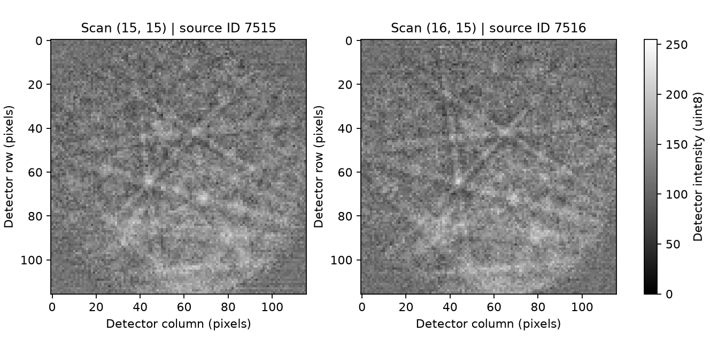

# Ti64 Raw Pattern Inspection

- Executable pipeline: `(01) Ti64 Raw Pattern Inspection.d3dpipeline`
- Source Material: The authors' complete `PyEBSDIndexDemo/Ti64 Demo/Ti64_index.ipynb` in the [PyEBSDIndex Demo dataset](https://zenodo.org/records/8400425). Expansion against the [related paper](https://doi.org/10.1107/S1600576723010221) is deferred until full text is available; this example does not reproduce its method or results.
- Input Data: The [public PyEBSDIndex Demo archive](https://zenodo.org/records/8400425), CC BY 4.0, supplies `Ti64_930C4hr_Scan4_cr.up1`. Prepare its first 32 scan rows and columns using the README recipe, retaining each complete detector pattern, and place the resulting `Ti64_930C4hr_Scan4_ROI32.up1` at `Data/PyEBSDIndex_Ti64/Ti64_930C4hr_Scan4_ROI32.up1`. This derived input is not installed or supplied as a public release asset.

**Before adapting:** Confirm scan order, detector layout, and coordinate conventions. Selecting neighboring patterns supplies inspection examples, not an indexing-quality rule.

> **Validation warning:** Do not treat this example as a validated acceptance procedure. Adapt and validate it for the scanner, material, resolution, and quality requirement.

## At a glance

- **Question:** How can two adjacent scan points be traced to their unmodified detector patterns and exported with acquisition identity?
- **Input:** 1,024 scan points at 0.25 micrometer XY spacing, each containing a 116×116 `uint8` detector pattern.
- **Result:** All input patterns in a checkpoint, two selected patterns, a 26,912-byte raw export, and a two-row identity manifest.
- **Scope:** Import, select, inspect, and hand off raw patterns. No denoising, indexing, phase labels, or orientation measurements are produced.

## Purpose and real-world setting

Use this workflow before external EBSD processing when you need a small, traceable pattern selection. The authors' notebook identifies the material as Ti-6Al-4V and the acquisition instrument as a Thermo Fisher Quadro SEM with an EDAX Velocity Super EBSD detector. This example uses that measured input without running the notebook's processing chain.

The two scan cells are a convenient adjacent pair inside the prepared crop. Their selection does not imply a grain boundary, a phase difference, or representative material behavior.

## Input data and assumptions

Prepare the file as described in the README, then place it at `Data/PyEBSDIndex_Ti64/Ti64_930C4hr_Scan4_ROI32.up1` relative to the working folder. No preceding pipeline is needed. The 13,778,986-byte UP1 derivative contains a 42-byte header and 13,778,944 intensity bytes. It selects source rows and columns 0–31 from a 500×500 scan; it is not the first 1,024 consecutive source patterns.

There are two independent grids. The **scan grid** locates acquired patterns; each cell is one array tuple. The **detector grid** contains 116×116 intensity components within each tuple. Native `Scan32/Cell Data/Patterns` therefore has tuple shape `[1,32,32]` in Z/Y/X order and component shape `[116,116]` in detector row/column order. Cropping scan cells retains complete detector images.

The created Image Geometry uses dimensions `[32,32,1]`, spacing `[0.25,0.25,1]`, and origin `[-0.125,-0.125,-0.5]` in micrometers. Its cell centers are `(0.25x,0.25y,0)` for zero-based scan indices. This is an explicitly chosen relative acquisition grid, not a recovered absolute specimen origin. Z spacing is a single-slice placeholder, not measured thickness. Detector pixels do not inherit this physical spacing.

## Data flow and parameter rationale

| Stage | Purpose and important choice |
|---|---|
| Create Geometry | Establish `Scan32` and its `Cell Data` Attribute Matrix with exactly 1,024 scan tuples. The geometry describes acquisition positions, not detector pixels. |
| Read EBSD Pattern File | Read the version-3 UP1 file into `Scan32/Cell Data/Patterns`. Preserve `uint8` intensities and detector component shape. No intensity normalization, rotation, interpolation, or background subtraction is applied. |
| Create local and source identities | `LocalScanIndex` runs from 0 through 1023. Calculate `SourceScanIndex = floor(LocalScanIndex / 32) * 500 + LocalScanIndex % 32` to retain the original file's row stride. |
| Crop Image Geometry | Copy inclusive bounds `[15,15,0]` through `[16,15,0]` into `Selected Patterns`. Both endpoints are included, so the result contains two scan cells. Keep `Scan32` with every input pattern. |
| Write Binary Data and Write ASCII Data | Export selected patterns and both identity arrays in matching tuple order. Include tuple zero: it is the first selected record, not a background row. |
| Write DREAM3D | Persist both geometries, all 1,024 imported patterns, the selected copy, and identity arrays together. |

## Outputs and interpretation

All files are written under `Data/Output/PyEBSDIndex_Ti64/Inspection/`:

- `Ti64_RawPatternInspection.dream3d`: retains `Scan32/Cell Data/Patterns` and `Selected Patterns/Cell Data/Patterns`, with their respective identity arrays.
- `SelectedPatternManifest.csv`: two rows containing `LocalScanIndex` and `SourceScanIndex`, as shown below. These are acquisition identities, not phase or feature IDs.
- `Patterns.bin`: headerless `uint8`, shape `(2,116,116)`, ordered by pattern, detector row, then detector column. The native selected tuple shape is `[1,1,2]`; the component shape remains `[116,116]`. Byte order has no effect on these one-byte values. This stream is not an EDAX UP1 file.

| LocalScanIndex | SourceScanIndex | Source scan (x, y) | Relative center (x, y), micrometers |
|---:|---:|---|---|
| 495 | 7515 | (15, 15) | (3.75, 3.75) |
| 496 | 7516 | (16, 15) | (4.00, 3.75) |

The preview supports visual inspection of the selected intensities. Pattern appearance alone does not establish phase identity, orientation accuracy, strain, or indexing confidence.

## Adaptation guidance and quality checks

For another pair, update both inclusive crop endpoints. Check the selected count, source IDs, and export byte count: `selected_count × detector_height × detector_width` for `uint8`. Compare the binary bytes with the corresponding source patterns and saved native array; a plausible image alone cannot detect reordered records.

For a different input crop, update geometry dimensions, spacing, relative origin, and the source-index formula together. A crop beginning at source `(x0,y0)` requires `(y0 + floor(i / crop_width)) * source_width + x0 + i % crop_width`. A 500-wide source stride must not silently become 32. Confirm source dimensions and dtype before reusing the binary contract, especially for UP2 inputs.

Keep scan directions separate from detector display directions. Before adding specimen-direction analysis, obtain the actual acquisition and frame conventions. Do not infer them from this relative Image Geometry. Scaling to the full input requires approximately 3.36 GB for intensity values alone, plus other arrays and processing overhead.

## Scientific basis and reuse

This is an **illustrative measured-data workflow**. The notebook processes patterns with NLPAR, refines a pattern center using a 5×5 selection starting at source `(300,300)`, indexes raw and processed patterns against alpha-Ti and beta-Ti phases, and exports indexing maps. None of those operations or outputs is reproduced here. The present 32×32 crop does not contain that notebook selection.

The [paper](https://doi.org/10.1107/S1600576723010221) provides the research context; its full text is needed before assessing a broader reproduction. The [dataset and bundled notebook](https://doi.org/10.5281/zenodo.8400425), by Rowenhorst and Callahan with contributor Ånes, provide the input and workflow context under CC BY 4.0. Credit them and identify the crop when reusing the data. No input dataset or downloaded notebook is included in this repository. Subset checksums do not establish verification of the complete source archive or member; consult `DataSources.json` for that distinction.

## Guidance for an LLM or MCP assistant

Use this example for raw-pattern import, acquisition selection, and external handoff. Preserve the tuple/component distinction, source-index formula, binary layout, and relative-coordinate qualification. Do not add phase, orientation, or quality claims from the figure. The `.d3dpipeline` is authoritative; change its arguments and both companions together when adapting it.
