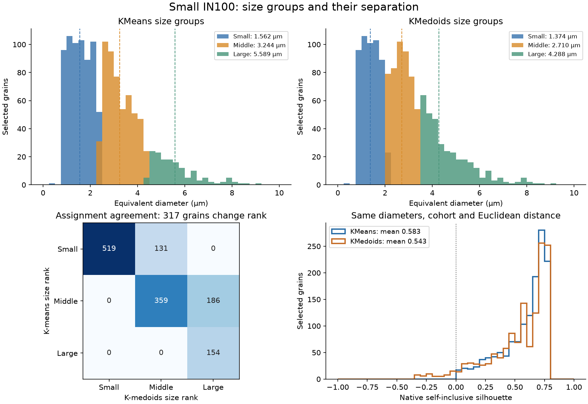

# Small IN100 Grain Size Groups and Representatives

- Executable pipeline: `(08) Small IN100 Grain Size Groups and Representatives.d3dpipeline`
- Source Material: [Groeber and Jackson (2014), DREAM.3D](https://doi.org/10.1186/2193-9772-3-5) (reconstruction and feature-analysis context; illustrative example).
- Input Data: [Small_IN100.tar.gz](https://www.dream3d.io/Data_Archive/Small_IN100.tar.gz): extract all 117 ANG sections to `Data/Small_IN100/` (also supplied in the normal example-data package). Run the documented predecessors to create `Data/Output/Small_IN100_Examples/SurfaceSelection/SmallIN100_SurfaceSelection.dream3d`.

> **Before adapting:** This example uses the supplied Small IN100 dataset. Check the selected grains, diameter units, and group count before applying it to other data. The `.d3dpipeline` is the executable authority.

## At a glance

| Question | Answer |
|---|---|
| What does it compare? | K-means arithmetic centers, K-medoids observed representative sizes, and both partitions' native silhouette scores for the same selected grains. |
| What comes first? | Archive → 01 preparation → 02 measurements → 03 surface selection → 08. |
| What is grouped? | One scalar equivalent sphere diameter in micrometers per selected feature. |
| What stays traceable? | Original cell `FeatureIds`, feature rows, geometry, measurements, and selection masks. |
| What is created? | Two group-ID arrays, two silhouette arrays, two center tables, three CSVs, and one DREAM3D checkpoint. |

## Purpose and real-world setting

Use this comparison to organize a grain table into exploratory size strata for inspection or sampling. An arithmetic center summarizes a group's sizes; a medoid is a size actually present in that group. Silhouette scores show how well each grain's diameter fits its assigned group relative to the nearest competing group. Three groups are illustrative, not evidence of physical populations, material phases, or spatially segmented regions.

## Inputs and data flow

The input is `Data/Output/Small_IN100_Examples/SurfaceSelection/SmallIN100_SurfaceSelection.dream3d`, produced by [example 03](%2803%29%20Small%20IN100%20Surface%20Selection%20Comparison.md). Follow the [suite quick start](README.md#quick-start-117-section-3d-example) from a writable working folder. Relative `Data/...` paths resolve there. The complete source is 117 measured EBSD sections reconstructed at 0.25 µm spacing; this branch uses their saved feature measurements.

Under `DataContainer/Cell Feature Data`, `EquivalentDiameters` comes from observed feature volumes. `InteriorFeatures` selects `NumElements > 0 AND SurfaceFeatures == 0`: selected grains have no detected contact with the image box or a face-adjacent background cell. This does not guarantee complete grains or an unbiased population. Both clustering filters independently read the same selected diameters. No component normalization is needed for one physical scalar.

## Filter choices

| Steps | Choice and reason |
|---|---|
| Read DREAM3D | Import the complete checkpoint so the cohort and original grain IDs remain available. |
| Compute K Means | Set three clusters, Euclidean distance, the existing mask, and seed 5489. Assign by nearest center and update arithmetic means; the associated objective is summed squared diameter error. |
| Compute K Medoids | Use the same three-cluster, distance, mask, and seed settings. In one dimension Euclidean distance is absolute diameter difference. Each representative minimizes total absolute distance within its assigned group. |
| Two Silhouette steps | Score each partition with the same diameters, `InteriorFeatures` mask, and Euclidean distance. Holding the input, cohort, and metric fixed makes separation comparable; only the assignments differ. |
| Three Write Feature Data CSV steps | Export the original feature table and each group table separately. Comma delimiters, no feature-count line, and no packed neighbor lists keep the tables rectangular. |
| Write DREAM3D | Save source data, both assignments and silhouette arrays, center tables, and stored seeds in one checkpoint. |

The algorithms iterate from sampled starting values without a global-optimum guarantee. A fixed seed supports repeatability in the same environment; different platforms or libraries can change the partition as well as its labels.

## Outputs and interpretation

All files are under `Data/Output/Small_IN100_Examples/GrainSizeGroups/`.

| File | Interpretation |
|---|---|
| `SmallIN100_GrainSizeGroups.csv` | `Feature_ID` is the original grain-table row. `KMeansSizeGroupIds` and `KMedoidsSizeGroupIds` give both assignments; `KMeansSizeSilhouette` and `KMedoidsSizeSilhouette` give their scores. Retain `InteriorFeatures` when selecting rows. |
| `SmallIN100_KMeansSizeCenters.csv` | `Feature_ID` is a K-means group ID; `MeanEquivalentDiameter` is in µm. |
| `SmallIN100_KMedoidsSizeRepresentatives.csv` | `Feature_ID` is a K-medoids group ID; `RepresentativeEquivalentDiameter` is in µm. |
| `SmallIN100_GrainSizeGroups.dream3d` | Source geometry and arrays plus both assignments, both silhouette arrays, center matrices, and `SizeKMeansSeed`/`SizeKMedoidsSeed`. |

Selected features receive group IDs 1–3. Excluded rows receive zero. Native group IDs have no size ordering and do not correspond between methods. Each DREAM3D center matrix has four rows; **ignore row 0**. Its K-means value includes excluded tuples, and its K-medoids value is zero. The CSV writer omits row 0 from every table.

A medoid diameter can match many original grain IDs. The output identifies a representative **size**; choose an actual grain separately from the original feature table. Do not compare summed squared errors in µm² with summed absolute errors in µm as a single quality score. CSV floating-point values are rounded to eight significant digits; use the DREAM3D arrays for full stored precision.

The native silhouette is `(b - a) / max(a, b)`: `a` is the mean distance to the assigned group and `b` is the smallest mean distance to another nonempty positive group. Here Euclidean distance is absolute diameter difference. **The native own-group mean includes zero self-distance and divides by group size `n`; the canonical leave-one-out mean divides by `n - 1`.** These native scores therefore need not match another silhouette library. Positive values indicate closer agreement with the assigned group; values near zero indicate overlap, and negative values suggest a closer competing group.

Interpret and summarize only `InteriorFeatures == true` rows with positive group IDs. Excluded rows and reserved row 0 have zero scores as placeholders, not measured zero separation. Require at least two nonempty positive groups and finite scores; identical distances can make the denominator zero. The common metric provides a useful diagnostic despite the methods' different optimization objectives. A higher score does not prove physical phases or a globally best method.

The preview orders groups by increasing center without changing saved IDs. Both size histograms use identical bins; the agreement table counts the same grains under both assignments. The score panel compares native silhouette distributions on common bins using selected rows only. In this result, 317 grains change size rank between methods.

| Size rank | K-means center (µm); grains | K-medoids size (µm); grains |
|---|---|---|
| Smallest | 1.561895; 650 | 1.374401; 519 |
| Middle | 3.243854; 545 | 2.710082; 490 |
| Largest | 5.589391; 154 | 4.287967; 340 |

| Native silhouette over selected grains | K-means | K-medoids |
|---|---|---|
| Mean | 0.582607 | 0.542910 |
| Minimum | 0.004440 | -0.319764 |
| Maximum | 0.774056 | 0.773284 |
| Grains with negative scores | 0 | 57 |

For this cohort, K-means has the higher mean native silhouette under absolute diameter difference. The negative K-medoids values identify grains worth inspecting near group boundaries; they do not invalidate observed representative sizes or establish a best method for another use.

## Observable checks and adaptation

The reference cohort has 1,349 selected grains from 2,317 occupied positive features. The table also retains 17 unused positive rows and reserved row 0. Confirm that only selected rows have positive group IDs, every group is populated, both CSV center tables contain exactly three rows, and the feature CSV retains all 2,334 positive rows. Check finite diameters and selected-row scores, nearest-center assignments, arithmetic means, and medoid membership and within-group absolute-distance minima. Compare score distributions and low-scoring grains, not just each method's mean score.

Rerun predecessors after changing spacing, labels, or the cohort. Review the scientific reason for a different group count and compare multiple initializations before relying on an adaptation. Adding shape or orientation components requires separate scaling and implementation review; this example is deliberately scalar. Do not pad scalar diameters with dummy components to use a spatial clustering filter.

## Scientific basis and assistant guidance

[Groeber and Jackson (2014)](https://doi.org/10.1186/2193-9772-3-5) provides the Small IN100 reconstruction and feature-analysis context. This clustering comparison is **illustrative**, not a reported paper result or numerical reproduction. The [public archive](https://www.dream3d.io/Data_Archive/Small_IN100.tar.gz) is separate from the publisher's processed supplements; source identity is unproven. Article terms are CC BY 2.0; raw-archive redistribution rights were not established. No volume data are included. The preview is derived from the native output, and the suite README records the archive checksum.

An LLM or MCP assistant should preserve the dependency chain, mask, units, and original IDs; explain group-row zero, representative-size ambiguity, and the native silhouette convention; and regenerate all sidecar parameters from the pipeline after edits. The [current filter source](https://github.com/BlueQuartzSoftware/simplnx) defines implementation behavior. `PythonGeneration.yaml` describes generation from the executable pipeline.
