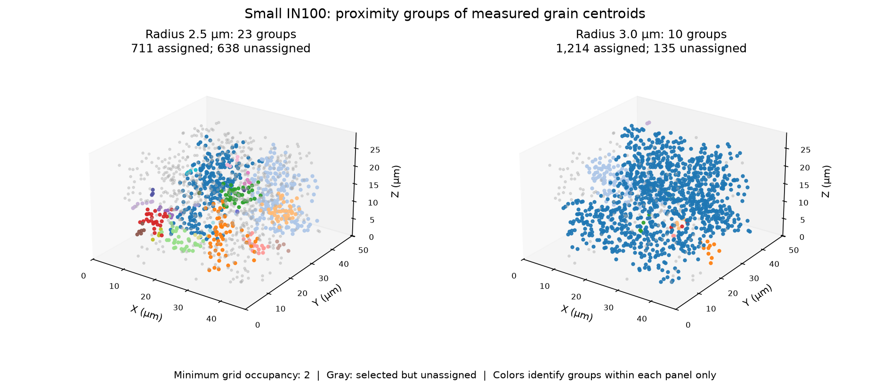

# Small IN100 Centroid Neighborhood Comparison

- Executable pipeline: `(09) Small IN100 Centroid Neighborhood Comparison.d3dpipeline`
- Source Material: [Groeber and Jackson (2014), DREAM.3D](https://doi.org/10.1186/2193-9772-3-5) provides reconstruction and feature-analysis context. The [DBSCAN](https://www.dream3d.io/nx_reference_manual/html/SimplnxCore/DBSCANFilter.html) and [Silhouette](https://www.dream3d.io/nx_reference_manual/html/SimplnxCore/SilhouetteFilter.html) documentation describes the filters used here.
- Input Data: [Small_IN100.tar.gz](https://www.dream3d.io/Data_Archive/Small_IN100.tar.gz): extract all 117 ANG sections to `Data/Small_IN100/` (also supplied in the normal example-data package). Run the predecessors below to create the surface-selection checkpoint.

> **Before adapting:** Do not treat this example as a validated acceptance procedure. Adapt and validate it for the scanner, material, resolution, and quality requirement.

## At a glance

| Question | Answer |
|---|---|
| What does it compare? | Spatial groups of interior-grain centroids at 2.5 and 3.0 µm proximity scales, including how many grains remain unassigned. |
| What comes first? | Archive → 01 preparation → 02 measurements → 03 surface selection → 09. Example 08 is a separate branch. |
| What is grouped? | The three physical coordinates of each selected grain centroid, all in micrometers. |
| What stays traceable? | Original cell `FeatureIds`, feature rows, geometry, measurements, and `InteriorFeatures`. |
| What is created? | Two group-ID arrays, two assignment masks, two silhouette arrays, three cell maps, a feature CSV, and a DREAM3D checkpoint. |

## Purpose and real-world setting

Use this example to inspect how a modest change in physical proximity joins nearby grain centroids into larger networks. It supports exploratory inspection of a measured microstructure; it does not test whether the material is spatially clustered relative to a random reference. The groups describe centroid locations, not grain-size classes, shared-boundary neighbors, phases, or new segmentation.

## Inputs and data flow

Read `Data/Output/Small_IN100_Examples/SurfaceSelection/SmallIN100_SurfaceSelection.dream3d`, produced by [example 03](%2803%29%20Small%20IN100%20Surface%20Selection%20Comparison.md). Follow the [suite quick start](README.md#quick-start-117-section-3d-example) from a writable working folder; relative `Data/...` paths resolve there. The source reconstruction uses 117 EBSD sections and 0.25 µm spacing on each axis.

In `DataContainer/Cell Feature Data`, `Centroids` stores physical X/Y/Z coordinates. `InteriorFeatures` selects `NumElements > 0 AND SurfaceFeatures == 0`, excluding detected image-box and face-adjacent background contact. That rule does not guarantee complete grains or an unbiased spatial sample. Both DBSCAN runs independently use the same 1,349 selected centroids. Keep all axes in micrometers; standardizing them separately would change physical distance.

## Filter choices and parameter rationale

| Steps | Choice and reason |
|---|---|
| 1: Read DREAM3D | Load the complete predecessor so each group remains linked to its original grain. |
| 2 and 5: DBSCAN | Use Euclidean distance, `InteriorFeatures`, Minimum Points 2, and Low Density First. Compare epsilon 2.5 and 3.0 µm without setting a desired group count. |
| 3 and 6: Multi-Threshold Objects | Make each `Assigned` mask from `InteriorFeatures > 0 AND corresponding group ID > 0`. This removes both excluded grains and unassigned noise from scoring. |
| 4 and 7: Silhouette | Score the assigned centroids under the same Euclidean metric, separately for each radius. |
| 8: Create Element Array from Feature Array | Copy both group-ID arrays and `InteriorFeatures` to cells with suffix `_Map`, using the original `FeatureIds`. |
| 9–10: Write Feature Data CSV and Write DREAM3D | Export the traceable feature table and save all source data plus the comparison arrays. |

The two radii are 10 and 12 source voxels, near the selected centroids' median nearest-neighbor distance of approximately 1.79 µm. They are illustrative nearby scales, not an inferred material length or an optimized choice.

This implementation uses a modified grid-based DBSCAN algorithm. In 3D its cell side is `epsilon / sqrt(3)`; Minimum Points 2 means two centroids in a grid cell can seed a cluster. It is not the conventional count of neighbors within epsilon around a point. Inter-cell connections require distance strictly below epsilon, and connected sparse cells can extend a group. Low Density First uses a deterministic order; the saved seed parameter is inactive and no seed array is created in this mode. These settings are not interchangeable with another library's DBSCAN settings.

## Outputs and interpretation

All files are under `Data/Output/Small_IN100_Examples/CentroidNeighborhoods/`.

| File or array | How to use it |
|---|---|
| `SmallIN100_CentroidNeighborhoods.csv` | Retains all 2,334 positive original feature rows. `Feature_ID` identifies the original grain-table row; retain `InteriorFeatures` and the radius-specific assignment masks. |
| `SmallIN100_CentroidNeighborhoods.dream3d` | Preserves the source and adds both partitions, score masks, scores, group matrices, and cell maps. Use stored arrays for full precision; CSV uses eight significant digits for float32 measurements and sixteen for float64 silhouette scores. |
| Feature arrays `CentroidDBSCAN2p5umIds` / `CentroidDBSCAN3umIds` | Positive values identify groups. Zero combines excluded rows and selected-but-unassigned grains. |
| Matching `Assigned` and `Silhouette` arrays | Summarize scores only where the corresponding assignment mask is true. Masked score zeros are placeholders. |
| Cell arrays `CentroidDBSCAN2p5umIds_Map`, `CentroidDBSCAN3umIds_Map`, `InteriorFeatures_Map` | Color the group maps categorically and inspect the cohort map to distinguish excluded cells from unassigned selected grains. `FeatureIds` remains unchanged. |

For the supplied dataset:

| Radius | Positive groups | Assigned of 1,349 | Unassigned selected grains | Mean native silhouette of assigned grains | Negative scores |
|---|---:|---:|---:|---:|---:|
| 2.5 µm | 23 | 711 (52.7%) | 638 | 0.012827 | 348 |
| 3.0 µm | 10 | 1,214 (90.0%) | 135 | -0.434083 | 1,136 |

Epsilon limits a local connection, not the diameter of a group. Chains can span much farther, as in the 1,050-grain group at 3.0 µm. Group numbers and colors have no correspondence between radii. Increasing the radius connects more grains here, but does not establish a better grouping. Silhouette favors compact, well-separated groups; long connected networks can have negative scores. The two means also summarize different assigned cohorts, so they cannot rank the radii on a common population.

The native score is `(b - a) / max(a, b)`. Its own-group mean `a` includes zero self-distance and divides by group size `n`; conventional silhouette uses `n - 1`. The competing mean `b` is the smallest mean distance to a different nonempty positive group. Preserve that convention when independently checking the output; cross-library numbers need not match.

## Checks, alternatives, and adaptation

Confirm finite selected centroids, at least two populated positive groups per scored result, finite scores in `[-1, 1]`, and masks equal to `InteriorFeatures AND IDs > 0`. An empty cohort, a single group, or a zero score denominator prevents meaningful interpretation. Reserved row 0 and 17 unused positive feature rows remain outside the cohort. Check that source arrays and all original feature IDs are unchanged and that each cell map equals its feature value indexed by `FeatureIds`.

Choose a new radius from the physical question, resolution, and centroid spacing; inspect coverage and group geometry together. Rerun predecessors after changing spacing, labels, or selection. The filter's grid occupancy rule, grid origin, and axis alignment can affect an adaptation. Use [example 06](%2806%29%20Small%20IN100%20Neighbor%20Relationships.md) for shared-boundary neighbors and [example 08](%2808%29%20Small%20IN100%20Grain%20Size%20Groups%20and%20Representatives.md) for scalar size groups. This workflow does not compute a radial distribution function or establish statistically significant clustering.

## Scientific basis and assistant guidance

[Groeber and Jackson (2014)](https://doi.org/10.1186/2193-9772-3-5) supplies the reconstruction and feature-analysis context. This centroid comparison is **illustrative**, not a reported result or paper reproduction. The article is CC BY 2.0; separate raw-archive redistribution terms and identity with the publisher's processed supplements were not established. No volume data are included. The preview is derived from native output; the [suite README](README.md) records archive provenance.

An LLM or MCP assistant should preserve the dependency chain, physical units, original IDs, cohort, and radius-specific score masks. Explain zero IDs and masked zero scores separately. Use the [pinned implementation](https://github.com/BlueQuartzSoftware/simplnx/tree/fe6c4a15e5a5bffef2523f52cec01be33b1e62a9/src/Plugins/SimplnxCore/src/SimplnxCore/Filters/Algorithms) for exact behavior and `PythonGeneration.yaml` to generate temporary Python from the executable pipeline. The `.d3dpipeline` is authoritative.
