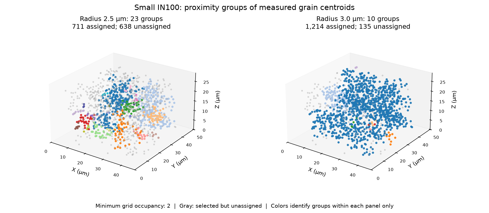

# Small IN100 Centroid Neighborhood Comparison

- Executable pipeline: `(09) Small IN100 Centroid Neighborhood Comparison.d3dpipeline`
- Source Material: [Groeber and Jackson (2014), DREAM.3D](https://doi.org/10.1186/2193-9772-3-5) provides reconstruction and feature-analysis context. The [DBSCAN](https://www.dream3d.io/nx_reference_manual/html/SimplnxCore/DBSCANFilter.html), [Silhouette](https://www.dream3d.io/nx_reference_manual/html/SimplnxCore/SilhouetteFilter.html), and [pinned implementations](https://github.com/BlueQuartzSoftware/simplnx/tree/fe6c4a15e5a5bffef2523f52cec01be33b1e62a9/src/Plugins/SimplnxCore/src/SimplnxCore/Filters/Algorithms) define the native behavior used here.
- Input Data: [Small_IN100.tar.gz](https://www.dream3d.io/Data_Archive/Small_IN100.tar.gz): extract all 117 ANG sections to `Data/Small_IN100/` (also supplied in the normal example-data package). Run Archive → 01 preparation → 02 measurements → 03 surface selection → 09. Example 08 is independent.

> **Before adapting:** Do not treat this example as a validated acceptance procedure. Adapt and validate it for the scanner, material, resolution, and quality requirement.

## At a glance

| Question | Answer |
|---|---|
| What is compared? | Two proximity groupings and nearest-centroid spacing for 1,349 interior grains. |
| What stays traceable? | Original feature rows, cell labels, measurements, and physical phases. |

## Purpose and real-world setting

Inspect how changing physical proximity from 2.5 to 3.0 µm joins measured grain centroids into larger networks. Nearest-centroid spacing supplies context for those choices. The groups describe centroid locations, not phases, grain-size classes, shared-boundary neighbors, or new segmentation. This exploration does not establish statistically significant spatial clustering.

Read `Data/Output/Small_IN100_Examples/SurfaceSelection/SmallIN100_SurfaceSelection.dream3d` from [example 03](%2803%29%20Small%20IN100%20Surface%20Selection%20Comparison.md). Follow the [suite quick start](README.md#quick-start-117-section-3d-example) from a writable folder; relative `Data/...` paths resolve there. Reconstruction uses 117 EBSD sections and 0.25 µm spacing on each axis.

`DataContainer/Cell Feature Data/Centroids` stores physical X/Y/Z coordinates. `InteriorFeatures` selects `NumElements > 0 AND SurfaceFeatures == 0`, excluding detected image-box and face-adjacent background contact. This does not guarantee complete grains or an unbiased spatial sample. All comparisons use the same 1,349 selected centroids. Keep axes in micrometers; separate axis standardization changes physical distance. Preserve original `FeatureIds`, feature rows, measurements, geometry, and physical phase arrays.

## Filter choices

| Steps | Choice and reason |
|---|---|
| 1–7: Read, two DBSCAN/mask/Silhouette sequences | Compare Euclidean radii 2.5 and 3.0 µm with `InteriorFeatures`, Minimum Points 2, and Low Density First. Each score mask is `InteriorFeatures AND corresponding group ID > 0`. |
| 8–10: Convert Data, Create Attribute Matrix, Compute Feature Clustering | Copy the mask to int32 `InteriorCentroidCohort`: 0 excluded, 1 selected. Select cohort 1 with Remove Biased Features false. Both endpoints are selected before constructing distances to every other selected centroid. |
| 11–12: Neighbor List Statistics, Delete Data | Compute length and minimum only. Delete the whole temporary RDF ensemble group and stored seed before export. |
| 13–15: Feature-to-cell mapping, CSV, DREAM3D | Map both group IDs, the cohort mask, and nearest distance through original `FeatureIds`; export the table and checkpoint. |

The integer cohort is an analysis ensemble, not a material phase. The filter requires a separate two-row ensemble for unused RDF outputs. One RDF bin minimizes unused histogram output; seed 5489 controls only the discarded random reference, not measured pair distances. [RDF normalization is defective in the pinned implementation](https://github.com/BlueQuartzSoftware/simplnx/issues/1820); this example neither retains nor corrects it.

Modified grid-based DBSCAN uses cell side `epsilon / sqrt(3)` in 3D. Minimum Points 2 means two centroids in a grid cell can seed a cluster, rather than the conventional point-neighborhood count. Inter-cell connections require distance strictly below epsilon; connected sparse cells can extend a group. Low Density First is deterministic and its DBSCAN seed is inactive. Grid origin and axis alignment can affect grouping.

## Outputs and interpretation

Files are under `Data/Output/Small_IN100_Examples/CentroidNeighborhoods/`:

| Output | Interpretation |
|---|---|
| `SmallIN100_CentroidNeighborhoods.csv` | All 2,334 positive original feature rows, existing measurements/grouping columns, plus cohort, distance count, and nearest distance. `Feature_ID` is the original grain-table row. Pair lists are omitted. |
| `SmallIN100_CentroidNeighborhoods.dream3d` | Complete source plus both partitions, scores/masks, group matrices, four cell maps, and distance outputs. No temporary RDF group or seed remains. |
| `CentroidDBSCAN2p5umIds` / `CentroidDBSCAN3umIds` | Positive IDs identify unordered groups. Zero combines excluded rows and selected-but-unassigned grains. Matching `Assigned` masks select meaningful `Silhouette` values. |
| `InteriorCentroidDistances` | Float32 distances in µm to all other selected rows, excluding self. Original feature rows index lists, not DBSCAN group IDs. |
| `InteriorCentroidDistanceCount` / `NearestInteriorCentroidDistance` | Each selected row has 1,348 distances. Excluded rows have empty lists, count zero, and minimum zero; that minimum is an invalid placeholder requiring `InteriorFeatures` and positive count. |
| Cell arrays with `_Map` suffix | Group IDs are categorical; nearest distance is continuous. Use `InteriorFeatures_Map` to mask excluded cells and distinguish them from unassigned selected grains. |

Nearest distance is center-to-center spacing within the selected cohort. It is **not a boundary gap, shared-boundary adjacency, or nearest-feature ID**. On other inputs, distinct selected grains can have coincident centroids and a valid zero minimum: use cohort and count, not `minimum > 0`, for validity. CSV retains eight significant digits for float32 measurements and sixteen for float64 silhouette scores; stored arrays retain full precision.

The selected nearest-centroid median is approximately 1.79 µm. The radii, 10 and 12 source voxels, are illustrative nearby scales, not optimized choices or an inferred material length.

| Radius | Positive groups | Assigned of 1,349 | Unassigned selected | Mean assigned native silhouette | Negative scores |
|---|---:|---:|---:|---:|---:|
| 2.5 µm | 23 | 711 (52.7%) | 638 | 0.012827 | 348 |
| 3.0 µm | 10 | 1,214 (90.0%) | 135 | -0.434083 | 1,136 |

Epsilon limits local connections, not group diameter: chains form a 1,050-grain group at 3.0 µm. Colors and group numbers do not correspond between panels. Silhouette favors compact, separated groups; connected networks can score negatively. Means cover different assigned populations and cannot rank radii on a common cohort.

The native score is `(b - a) / max(a, b)`. Own-group mean `a` includes zero self-distance and divides by `n`; conventional silhouette uses `n - 1`. Competing mean `b` is the smallest mean distance to another nonempty positive group. Masked score zeros are placeholders.

## Checks and adaptation

Confirm finite selected centroids, nonzero pair-distance range, exact distance counts, and mask/map consistency. Require at least two populated positive groups and finite scores in `[-1, 1]` before interpreting silhouette. Reserved row 0 and 17 unused positive rows remain excluded. Check unchanged source arrays and map equality to feature values indexed by `FeatureIds`.

Lists contain 1,818,452 directed float32 entries, about 7.3 MB of values plus overhead and the fixed 1,000-point reference calculation. Work and storage grow quadratically with selected feature count; this is not a voxel all-pairs workflow. Rerun predecessors after changing spacing, labels, or selection. Use [example 06](%2806%29%20Small%20IN100%20Neighbor%20Relationships.md) for shared-boundary neighbors and [example 08](%2808%29%20Small%20IN100%20Grain%20Size%20Groups%20and%20Representatives.md) for size groups.

## Scientific basis and assistant guidance

This comparison is **illustrative**, not a reported result or paper reproduction. The article is CC BY 2.0; separate archive redistribution terms and identity with the publisher's processed supplements were not established. No volume data are included. The preview comes from native output; [suite provenance](README.md) records the archive.

An LLM or MCP assistant should preserve the chain, units, original IDs, separate analysis cohort, score masks, and removal of temporary RDF outputs. Explain excluded zero minima separately from measurements. Use `PythonGeneration.yaml` for temporary generated Python; the `.d3dpipeline` is authoritative.
