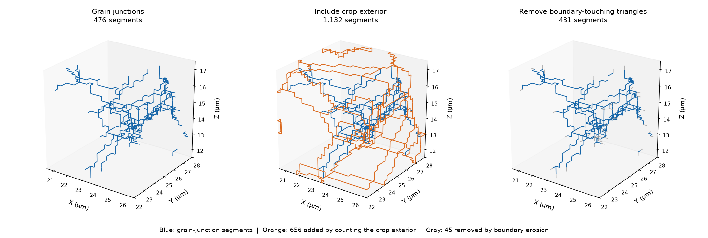

# Small IN100 Triple Lines and Crop Boundaries

- Executable pipeline: `(04) Small IN100 Triple Lines and Crop Boundaries.d3dpipeline`
- Source Material: [DREAM3D-NX discussion #44](https://github.com/BlueQuartzSoftware/DREAM3DNX-Issues/discussions/44) (request for connected triple-line geometry); [Extract Triple Lines](https://github.com/BlueQuartzSoftware/simplnx/blob/fe6c4a15e5a5bffef2523f52cec01be33b1e62a9/src/Plugins/SimplnxCore/docs/ExtractTripleLinesFilter.md) (filter behavior); [Groeber and Jackson (2014), DREAM.3D](https://doi.org/10.1186/2193-9772-3-5) (inherited reconstruction context).
- Input Data: [Small_IN100.tar.gz](https://www.dream3d.io/Data_Archive/Small_IN100.tar.gz): extract all 117 ANG sections to `Data/Small_IN100/` (also supplied in the normal example-data package). Run Archive → Feature Preparation → geometry example 01 to create `Data/Output/Small_IN100_Geometry_Examples/Surface/SmallIN100_SurfaceMesh.dream3d`.

> **Before adapting:** Do not treat this example as a validated acceptance procedure. Adapt and validate it for the scanner, material, resolution, and quality requirement. The crop walls are artificial boundaries, and removing faces near them changes the junction network.

## At a glance

| Item | Contract |
| --- | --- |
| Prerequisite | `(01) Small IN100 Surface Mesh.d3dpipeline`; smoothing and transform/export are not required |
| Input geometry | Original, unsmoothed `SurfaceMesh`, imported with all its child arrays |
| Three line geometries | `InteriorTripleLines`, `ExteriorIncludedTripleLines`, `BoundaryErodedTripleLines` |
| Comparison surface | `BoundaryErodedMesh`, retaining only triangles whose three node types are in `[0,8]` |
| Output | `Data/Output/Small_IN100_Geometry_Examples/Junctions/SmallIN100_TripleLines.dream3d` |
| Required software | A recent matching build that registers `ExtractTripleLinesFilter` and the current internal-surface filter parameters |

## Purpose and real-world setting

Grain-boundary junctions can be inspected as lines, but a threshold on mesh vertices still displays triangle facets. This example extracts actual shared mesh edges where at least three regions meet. It compares a grain-only selection with one that counts the crop exterior, then shows how deliberately removing triangles near the crop wall changes the remaining network.

This is a partial response to discussion #44. It provides connected edge geometry and a count of adjacent regions. It does not provide the adjacent grain-ID tuples, ordered continuous chains, a triple-junction line orientation distribution (TJLOD), directions in neighboring crystal frames, or a hardening prediction.

## Input data and assumptions

The source is a measured-derived 24 × 24 × 24-cell crop at 0.25 µm spacing, spanning 6 µm along each axis. Its unsmoothed mesh contains 6,479 vertices, 14,052 triangles, and 23 positive original grain IDs. `FaceLabels` identify the regions on both sides of each triangle; this crop has `-1` for the exterior and no label zero. `FeatureIds` remain the preparation grain IDs, not twin-parent `ParentIds`.

Triangles must share vertex indices along their common edges. Coincident coordinates alone do not establish connectivity; an STL imported with duplicated vertices can therefore lose the junctions this filter needs. This example keeps the shared connectivity from SurfaceNets and does not smooth, remesh, transform, or renumber the source.

The current SurfaceNets classification uses `2`, `3`, and `4` for ordinary internal vertices, triple-line vertices, and vertices touching four or more regions. Bounding-box vertices use `12`, `13`, and `14`; their classification includes the outside region. Older node-type conventions must be checked before reusing this range.

## Data flow and filter choices

Read `SurfaceMesh` → extract with exterior off and on → create a separate boundary-eroded surface → extract its grain-only junctions → save the baseline and all comparisons.

| Filter and choice | Why it is here | Alternatives and pitfalls |
| --- | --- | --- |
| `ReadDREAM3DFilter`, include-list policy `1` | Import only `SurfaceMesh` and its arrays | Policy `0` imports every object even when a path list is supplied |
| `ExtractTripleLinesFilter`, exterior false | Keep shared edges with at least three distinct nonnegative adjacent labels | A vertex threshold does not test edge ownership. Grain-only junctions may still reach the crop wall |
| Same filter, exterior true | Show the extra lines created when the outside counts as one region | All negative labels normalize to one outside region. Here the additional lines lie on artificial crop boundaries, not a measured specimen free surface |
| `ExtractInternalSurfacesFromTriangleGeometryFilter`, Node Type Range `[0,8]` | Retain a triangle only if all three node types are in range | This removes caps and a rim of internal faces touching the wall. It is a boundary-erosion control, not an exact selection of all internal interfaces |
| Internal-surface Face Labels criterion, not selected | Explain why label mode is not a substitute for the erosion control | It removes only `{-1,0}` faces. This crop has no zero labels, so that mode would retain every triangle, including caps against positive grains |
| Copy `NodeTypes` and `FaceLabels` through erosion | Preserve source classifications and triangle owners on retained elements | NodeTypes are copied from the original mesh; they are not recomputed after faces are removed |
| `CreateGeometryFilter`, Copy/Micrometer | Give each new Edge or Triangle Geometry explicit µm metadata while keeping its coordinates and connectivity | Explicit unit construction avoids the metadata loss reported in [simplnx#1813](https://github.com/BlueQuartzSoftware/simplnx/issues/1813). Setting metadata here does not rescale coordinates |
| `CopyDataObjectFilter` then `DeleteDataFilter` | Transfer the matching `NodeTypes` and `NumFeatures` or `FaceLabels`, then remove temporary geometry | Do not copy old face measurements onto the reduced mesh |

`ExtractTripleLinesFilter` gathers labels from every triangle incident on each shared edge. It ignores negative labels when exterior is off, and counts their normalized outside region when exterior is on. **Label zero always counts as a region**, including when it represents background or bad data. `NodeTypes` are optional copied attributes; they never decide which edges qualify.

## Outputs and interpretation

The figure compares the same bounded 6 µm region under the three policies. Blue shows retained grain-junction segments, orange marks segments added by counting the crop exterior, and gray marks segments removed by boundary erosion. The original `SurfaceMesh` remains available for overlay, and `BoundaryErodedMesh` shows which surface was used for the third branch.

| Geometry | Meaning |
| --- | --- |
| `InteriorTripleLines` | Junction edges counted from the original mesh with negative labels excluded |
| `ExteriorIncludedTripleLines` | Junction edges from the same original mesh with the outside counted as one region |
| `BoundaryErodedMesh` | Retained triangles and vertices after the all-three-node range selection |
| `BoundaryErodedTripleLines` | Junction edges recomputed from the reduced surface, with negative labels excluded |

The supplied crop produces:

| Line geometry | Vertices | Segments | Sum of segment lengths (µm) | Segments with `NumFeatures=4` |
| --- | ---: | ---: | ---: | ---: |
| `InteriorTripleLines` | 465 | 476 | 119.00 | 9 |
| `ExteriorIncludedTripleLines` | 1,055 | 1,132 | 283.00 | 9 |
| `BoundaryErodedTripleLines` | 419 | 431 | 107.75 | 7 |

Counting the exterior adds 656 segments. Boundary erosion removes 8,172 triangles, leaving 3,011 vertices and 5,880 triangles; its junction network loses 45 segments. The length sums above are computed from the saved edge endpoint coordinates; the filter does not write a length array. They describe the discrete unsmoothed mesh, not validated physical line lengths or bulk line densities.

Each line geometry contains `Edge Data/NumFeatures`, an `int8` value per edge: `3` means three counted regions, and `4` means four **or more**. This saturated count is not the identities of the adjacent grains. The nine baseline segments marked `4` require care: their mesh incidence does not establish physical four-grain lines, and discretization can affect that interpretation. `Vertex Data/NodeTypes` carries the source vertex classification. Edge connectivity represents a graph of segments, not preassembled ordered curves.

All five saved geometries explicitly use Micrometer units. Only the original mesh and the four new comparison geometries are imported or published; the cropped image and alternative meshes stay in the predecessor checkpoint. No raw or processed volume is distributed with this example.

## Adaptation and quality checks

| Check before interpreting a new dataset | Why it matters |
| --- | --- |
| Confirm the label convention, including zero and negative values | Background zero participates in junction counts; all negative values form one outside region |
| Compare actual edge sets with exterior off and on | Added crop-wall segments can dominate a small region and should not be called bulk grain junctions |
| Inspect the surface removed by the node range | Erosion can truncate internal sheets and shorten or disconnect junctions; it is not a correction to the physical network |
| Keep shared vertex indices and inspect empty-output warnings | Duplicated vertices can prevent incident triangles from sharing an edge |
| Check units and overlay line vertices on the source mesh | Unit metadata must match coordinates; line coordinates should remain on the mesh used for extraction |
| Re-extract after changing the source geometry | Each output owns its coordinates; later smoothing of the source does not update the lines |

To compare smoothed junctions, add a separate extraction from the chosen smoothed surface and describe that surface's boundary policy. To calculate TJLOD or crystal-frame directions, first add and verify explicit edge-to-grain ownership and a declared line-direction or chain convention. The present arrays do not supply those prerequisites.

## Scientific basis and limits

[Discussion #44](https://github.com/BlueQuartzSoftware/DREAM3DNX-Issues/discussions/44) motivates the connected-line use case. Its historical node-type description and available-filter status do not describe the current implementation. The [current triple-line documentation](https://github.com/BlueQuartzSoftware/simplnx/blob/fe6c4a15e5a5bffef2523f52cec01be33b1e62a9/src/Plugins/SimplnxCore/docs/ExtractTripleLinesFilter.md), [internal-surface criterion documentation](https://github.com/BlueQuartzSoftware/simplnx/blob/fe6c4a15e5a5bffef2523f52cec01be33b1e62a9/src/Plugins/SimplnxCore/docs/ExtractInternalSurfacesFromTriangleGeometryFilter.md), and [SurfaceNets node classifications](https://github.com/BlueQuartzSoftware/simplnx/blob/fe6c4a15e5a5bffef2523f52cec01be33b1e62a9/src/Plugins/SimplnxCore/docs/SurfaceNetsFilter.md#node-types) support the choices above.

[Groeber and Jackson (2014)](https://doi.org/10.1186/2193-9772-3-5) provide the inherited three-dimensional microstructure reconstruction context. This crop and junction comparison have **illustrative** reproduction status; they do not reproduce a named paper result or introduce a new paper-method claim. Identity between the public raw archive and publisher outputs remains unproven. The article is CC BY 2.0; separate raw-archive redistribution terms were not established.

## Guidance for an LLM or MCP assistant

Treat the `.d3dpipeline` as executable authority. Preserve the original shared mesh and compare both exterior settings against it. Describe the `[0,8]` branch as boundary erosion, retain the explicit Micrometer metadata, distinguish region counts from grain IDs, and do not infer ordered chains, crystal-frame orientations, TJLOD, or mechanical response from the saved arrays.
