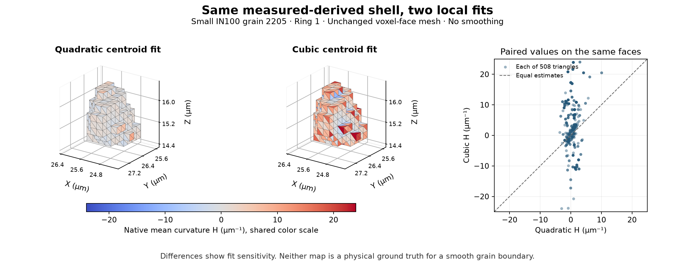

# Small IN100 Grain Curvature Fit Comparison

- Executable pipeline: `(05) Small IN100 Grain Curvature Fit Comparison.d3dpipeline`
- Source Material: [Groeber and Jackson (2014), DREAM.3D](https://doi.org/10.1186/2193-9772-3-5) (reconstruction setting); [Goldfeather and Interrante (2004), A Novel Cubic-Order Algorithm for Approximating Principal Direction Vectors](https://doi.org/10.1145/966131.966134) ([author PDF](https://www-users.cse.umn.edu/~interran/papers/tog04.pdf), local-fit methods and limitations).
- Input Data: [Small_IN100.tar.gz](https://www.dream3d.io/Data_Archive/Small_IN100.tar.gz): extract all 117 ANG sections to `Data/Small_IN100/` (also supplied in the normal example-data package). Run the documented predecessors through stage 02 to create `Data/Output/Small_IN100_Grain_Surface_Examples/Measurements/SmallIN100_Grain2205_Measurements.dream3d`.

**Before adapting:** Establish the surface resolution, topology, orientation, and neighborhood scale for the measurement. These fits describe an unsmoothed, faceted grain envelope. They do not establish physical smooth grain-boundary curvature, stress, boundary energy, or growth rate.

## At a glance

| Item | This example |
|---|---|
| Task | Compare quadratic and cubic local fits on the same complete grain envelope. |
| Prerequisite | Stage 02's saved measurements file; stages 03 and 04 are independent branches. |
| Input | Measured-derived grain 2205: 508 faces, 256 vertices, 0.25 micrometer source spacing. |
| Output | Both fits' principal curvatures, mean and Gaussian curvature, and principal directions on unchanged geometry. |
| Main choices | Ring 1, identical centroids and seed normals, preserved source identity, no smoothing. |
| Reproduction status | Illustrative local-fit comparison; the full published adjacent-normal method is not reproduced. |

## Purpose and real-world setting

Curvature fields help inspect where a reconstructed surface changes shape and how sensitive that description is to the fitting model. Keeping the same shell and neighborhood makes this a comparison of polynomial terms. A larger value or a smoother-looking field does not establish better accuracy. For whole-grain size and shape, stage 02's area and volume are simpler summaries; local curvature answers a different question.

The source is a binary envelope between grain 2205 and its complement, derived from a reconstructed EBSD volume. Its flat facets and sharp joins are not samples of a known smooth boundary. Fitted values depend on that representation and should be interpreted as a diagnostic of it.

## Input contract and parameter choices

Run [(02) Small IN100 Grain Surface Measurements](%2802%29%20Small%20IN100%20Grain%20Surface%20Measurements.md) first. The [category README](README.md) gives the complete chain and working-directory setup. This stage imports only `Grain2205`, computes `CurvatureFaceCentroids`, fits both alternatives, and saves the shell with its existing identity arrays.

`SurfaceRegionIds` is 1 on every face and is paired with uniform `LocalSurfaceLabels = [-1,1]`. This groups the complete grain-versus-complement envelope. `OriginalFaceLabels` retains six original neighboring-grain pairs for provenance. **Never pair the all-one region IDs with those mixed original pairs.** Analysis of separate physical interfaces needs consistent pair-based grouping and a separate treatment of interface edges and triple lines.

Ring 1 includes the seed face and qualifying triangles sharing a vertex with it: 9–19 triangles per patch here. It is the smallest local neighborhood, not a distance in micrometers. There is no physical-distance parameter. A known [local-frame defect](https://github.com/BlueQuartzSoftware/simplnx/issues/1819) can produce nonfinite directions without a reported error, including on a closed cube with ring 2. This ring-1 comparison is specific to this shell; it does not establish valid fits on another mesh. Larger rings change the sampled surface and are not automatically better.

Both fits use the seed face normal to define a local tangent frame and fit neighboring **face centroids**, not mesh vertices:

| Output prefix | `use_normals` | Terms in the current implementation |
|---|---|---|
| `Quadratic` | `false` | Three terms: x²/2, xy, y²/2. |
| `Cubic` | `true` | The same three terms plus x³, x²y, xy², y³. |

The GUI calls this toggle **Use Face Normals for Curve Fitting**. In the current implementation it adds cubic centroid terms; it does not add adjacent-normal equations or row weighting. Normals are required in both modes. Goldfeather and Interrante's section 4.3 fits vertex positions together with two constraints from each adjacent vertex normal and scales the equations. Its reported accuracy advantage therefore cannot be transferred to this comparison. Weingarten matrix output stays disabled because that option is documented as experimental.

## Outputs and interpretation

The output is `Data/Output/Small_IN100_Grain_Surface_Examples/Curvature/SmallIN100_Grain2205_Curvature.dream3d`. Create the `Curvature` folder under the CLI working directory before execution; use absolute file parameters in the GUI when needed.

Under `Grain2205/Face Data`, each prefix has `K1`, `K2`, `Mean`, `Gaussian`, `Direction1`, and `Direction2`. The principal curvatures satisfy K1 ≥ K2; Mean = (K1 + K2)/2 and Gaussian = K1 × K2. K1, K2, and Mean have units µm⁻¹; Gaussian has units µm⁻². `CurvatureFaceCentroids` has XYZ coordinates in micrometers. Direction arrays are unit tangent vectors in the geometry's coordinate system.

The surface panels share a −24 to +24 µm⁻¹ scale. The scatter compares every face with the equality line. Reference-run Mean values are:

| Fit | Minimum (µm⁻¹) | Median (µm⁻¹) | Maximum (µm⁻¹) |
|---|---:|---:|---:|
| Quadratic | −3.5829 | 0.4584 | 10.0773 |
| Cubic | −23.9783 | 2.8615 | 23.9784 |

These values show substantial fit sensitivity on this faceted input; they are not physical acceptance limits or evidence that either fit is superior. Reversing winding changes the normal orientation and signed curvature convention. Principal directions are axes: a vector and its negative describe the same direction. They are nonunique at equal principal curvatures and unstable near equality; do not interpret arbitrary direction flips as a physical discontinuity.

## Adapting the workflow

Check closed-shell topology, winding, units, finite centroids and normals, and consistent labels before fitting another grain. Inspect finite outputs and tangent directions alongside the mesh, especially at sharp joins. Keep original identities separate from local grouping. A smoothing or remeshing study must preserve the original surface and assess changes to geometry, scale, and curvature; this pipeline performs neither. Compare candidate neighborhoods against a suitable geometric reference rather than choosing the largest ring or highest polynomial degree.

Groeber and Jackson provide the reconstruction setting, not a numerical target for this grain. The Goldfeather paper explains local-fit sensitivity and direction ambiguity; its test surfaces, vertex sampling, and complete adjacent-normal method differ from this workflow. The example is **illustrative**. The reconstruction article is CC BY 2.0; separate source-archive redistribution terms are unestablished. No raw or processed volume is included here; the category README records archive provenance and checksum.

For an LLM or MCP assistant, treat the pipeline as executable authority. Preserve the stage 02 prerequisite, both fit settings, ring 1, local grouping, original labels, units, and unchanged geometry. Explain the actual toggle behavior and the diagnostic scope before adapting the example.
