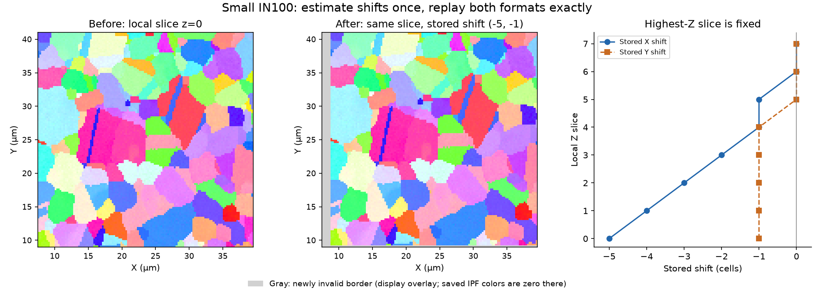

# Small IN100 section alignment and replay

- Executable pipeline: `(02) Small IN100 Section Alignment and Replay.d3dpipeline`
- Source Material: [Align Sections (Mutual Information)](https://github.com/BlueQuartzSoftware/simplnx/blob/fe6c4a15e5a5bffef2523f52cec01be33b1e62a9/src/Plugins/OrientationAnalysis/docs/AlignSectionsMutualInformationFilter.md) and [Align Sections (List)](https://github.com/BlueQuartzSoftware/simplnx/blob/fe6c4a15e5a5bffef2523f52cec01be33b1e62a9/src/Plugins/SimplnxCore/docs/AlignSectionsListFilter.md) describe the operations; [Groeber and Jackson (2014), DREAM.3D](https://doi.org/10.1186/2193-9772-3-5) supplies serial-section workflow context.
- Input Data: [Small_IN100.tar.gz](https://www.dream3d.io/Data_Archive/Small_IN100.tar.gz), also supplied in the normal example-data package. Run **Archive → Feature Preparation → this example** to create and consume `Data/Output/Small_IN100_Examples/Preparation/SmallIN100_Features.dream3d`.

**Before adapting:** Confirm section order, orientation conventions, phase symmetry, mask meaning and spatial units. Inspect estimated shifts against independent acquisition information.

> **Validation warning:** Do not treat this example as a validated acceptance procedure. Adapt and validate it for the scanner, material, resolution, and quality requirement.

## At a glance

| Item | This example |
|---|---|
| Task | Estimate XY translations between eight measured sections, then replay the same shifts in relative and cumulative form. |
| Input | The already aligned and cleaned Feature Preparation checkpoint. |
| Region | Inclusive XYZ voxel bounds `[30,36,52]` to `[157,163,59]`: 128 × 128 × 8 cells at 0.25 micrometers in each direction. |
| Anchor | Highest local Z section, `z=7`; all three aligned results share this fixed reference. |
| Result | An untouched crop, three aligned versions, and an eight-row shift CSV. |
| Limit | This is an alternative pattern estimate and replay demonstration, not a recovery of original acquisition motion or a reproduction of a paper result. |

## Purpose and real-world setting

Serial-section EBSD reconstruction places orientation maps from successive exposed surfaces into a common volume. A useful alignment workflow separates **estimating a translation** from **applying a recorded translation**. Keeping those operations separate lets another set of cell attributes receive exactly the same correction and makes the chosen shifts inspectable.

Mutual-information alignment groups orientations into temporary features on each section, then searches for translations that improve correspondence between neighboring feature patterns. It does not use the retained `FeatureIds` to estimate those patterns. This example saves its estimates and applies each shift representation to a separate untouched copy. Agreement between those results establishes consistent replay; it does not establish the physical accuracy of the estimated alignment.

## Input data and run order

1. Extract all 117 ANG files from the public archive to `Data/Small_IN100/` in a writable working folder.
2. Run [(01) Small IN100 Archive](%2801%29%20Small%20IN100%20Archive.md), which writes `Data/Output/Reconstruction/Small_IN100.h5ebsd`.
3. Run [(01) Small IN100 Feature Preparation](../Small_IN100_Examples/%2801%29%20Small%20IN100%20Feature%20Preparation.md), which writes the checkpoint named above.
4. Run this pipeline from the same working folder. The [category README](README.md) gives CLI commands. In the GUI, open each pipeline with **File > Open** and set absolute file paths if the relative `Data/...` paths do not resolve.

The preparation already includes section alignment, orientation and mask repair, segmentation, and cleanup. These eight sections therefore represent a processed cohort of real measured sections. They are not an unaligned acquisition or repeated copies of one plane. A second alignment can overcorrect real changes in 3D grain morphology between sections; an improved pattern score does not distinguish that change from acquisition drift. Local `z=0..7` corresponds to prepared-volume indices `52..59`; these are not raw ANG filenames.

Every input cell in this crop has `Phases=1` and `Mask=1`, with finite unit quaternions and the inherited cubic-high crystal symmetry. No artificial translation or new input dataset is introduced. Geometry dimensions, origin, spacing and Micrometer units remain fixed during alignment; only cell-array contents move within that grid.

## Data flow and parameter rationale

The 17 executable steps are grouped here by purpose.

| Operation and filters | Choice and reason |
|---|---|
| Read DREAM3D; Delete Data | Read the preparation checkpoint. Retain `Quats`, `Phases`, `Mask`, `FeatureIds`, `IPFColors`, and ensemble `CrystalStructures`. Remove whole-volume feature/parent statistics that no longer describe the crop; omit unused cell channels to keep the comparison focused. |
| Crop Image Geometry | Use eight consecutive 128 × 128 sections so the alternative estimate is quick to inspect. Keep `renumber_features=false`: source feature labels remain recognizable, sparse identifiers. They are transported attributes, not newly segmented grains. |
| Create Geometry; Copy Data Object | Preserve `DataContainer_Before` and two independent replay copies with the same geometry and explicit Micrometer units. Copy all five cell arrays before any alignment so each method starts from the same data and highest-Z anchor. |
| Align Sections (Mutual Information) | Use **5 degrees** to group orientations into temporary section features. This illustrative choice follows the preparation's orientation tolerance; it is not a calibrated optimum. Smaller tolerances can fragment noisy patterns, while larger values can merge low-angle boundaries. Store the slice pairs and both shift representations in `DataContainer/MI Alignment`. |
| Mask and phase selection | Keep the existing mask and phase information together. The chosen crop is entirely valid before alignment; this example does not demonstrate arbitrary masked-region handling. When adapting, check rejected regions explicitly rather than assuming the mask excludes every neighbor considered during temporary grouping. |
| Align Sections (List), twice | Select **Relative [0]** for `DataContainer_ReplayRelative` and **Cumulative [1]** for `DataContainer_ReplayCumulative`. Use the saved two-component integer arrays directly. All five cell arrays move together, keeping orientation, phase, validity, labels and colors attached to the same source cells. |
| Write DREAM3D; Write ASCII Data | Save the four geometries and shift arrays, then export all eight rows with headers and a zero-based index. Row 0 is needed to retain the anchor convention. |

## Read the shifts correctly

Shift components are **X then Y, in integer cells**. Rows run from highest to lowest Z. For eight sections, row `r` addresses local section `z=7-r`. Row 0 is the fixed anchor: its shifts are `[0,0]`, and its `Slice Indices=[0,0]` is a placeholder, **not a pair identifying local section 0**. Rows 1–7 identify the moving and next-higher section.

The filter documentation's ambiguous row-order guidance is tracked in [simplnx #1815](https://github.com/BlueQuartzSoftware/simplnx/issues/1815); use the explicit row and sign convention here for this example.

| CSV row | Local Z | Slice Indices | Relative X, Y | Cumulative X, Y |
|---:|---:|---|---|---|
| 0 | 7, anchor | `[0,0]` placeholder | `[0,0]` | `[0,0]` |
| 1 | 6 | `[6,7]` | `[0,0]` | `[0,0]` |
| 2 | 5 | `[5,6]` | `[-1,0]` | `[-1,0]` |
| 3 | 4 | `[4,5]` | `[0,-1]` | `[-1,-1]` |
| 4 | 3 | `[3,4]` | `[-1,0]` | `[-2,-1]` |
| 5 | 2 | `[2,3]` | `[-1,0]` | `[-3,-1]` |
| 6 | 1 | `[1,2]` | `[-1,0]` | `[-4,-1]` |
| 7 | 0 | `[0,1]` | `[-1,0]` | `[-5,-1]` |

These values describe the reference run on this preparation checkpoint. Cumulative row `r` is the sum of relative rows 1 through `r`. A stored cumulative shift `(sx,sy)` samples the source as:

```text
output[z,y,x] = before[z,y+sy,x+sx]  when that source cell is in bounds
output[z,y,x] = 0                   otherwise
```

Thus **negative shifts move visible features toward positive X/Y**. The largest absolute shifts here are five X cells (1.25 micrometers) and one Y cell (0.25 micrometers). Those are magnitudes of the estimated correction on this processed crop, not independently measured acquisition translations. No rotation, interpolation or section-spacing correction is performed.

## Outputs and interpretation

Open `Data/Output/Small_IN100_Processing/Alignment/SmallIN100_SectionAlignment.dream3d` and compare matching XY sections:

| Geometry | Meaning |
|---|---|
| `DataContainer_Before` | Untouched crop of the processed preparation checkpoint. |
| `DataContainer` | Mutual-information estimate applied to the crop. |
| `DataContainer_ReplayRelative` | The same crop moved using the stored relative shifts. |
| `DataContainer_ReplayCumulative` | The same crop moved using the stored cumulative shifts. |



The preview comes from the native saved output, not a paper figure. It shows local `z=0` before and after alignment on common axes, plus cumulative shifts plotted against local Z. Gray marks invalid border cells as a display overlay; the saved IPF colors there are zero. Color identifies crystal direction relative to the inherited sample reference, not displacement magnitude. The three aligned results agree for all five cell arrays, including borders. The highest local section remains identical to `Before`.

Open `Data/Output/Small_IN100_Processing/Alignment/SmallIN100_Shifts.csv` to inspect `Index`, the two `Slice Indices` components, and the X/Y components of `Relative Shifts` and `Cumulative Shifts`. It contains eight data rows plus a header. The pipeline replays the in-memory arrays; the CSV is a readable export, not an extra input dependency.

Shifting retains 128,399 of the original 131,072 cells and exposes 2,673 zero-filled border cells. There, `Mask=0`, `Phases=0`, `FeatureIds=0`, `IPFColors=0`, and `Quats=[0,0,0,0]`. These are invalid/background tuples, not valid zero-angle orientations. Original labels remain sparse and may lose cells at the crop edge. No feature statistics remain; recompute any needed measurements from the final geometry and an explicitly chosen feature definition.

## Adaptation and quality checks

- Verify the input checkpoint and physical section ordering before interpreting row order. Do not silently sort the shift rows into ascending Z.
- Inspect continuity across neighboring sections, the fixed anchor, clipped features and new borders. An attractive map or exact replay alone does not prove correct physical alignment.
- Check orientation units and conventions, phase-to-symmetry lookup, and mask meaning before changing the crop or dataset. Invalid padding must have phase zero and a false mask; zero quaternions must not be treated as normalized orientations.
- Change the tolerance deliberately and compare against fiducials, acquisition records or other independent evidence. Local pattern searches can settle on an incorrect translation, particularly with weak overlap, repeated patterns, or changing section morphology.
- Preserve all cell attributes that must follow the correction. Review feature measurements after any crop or shift; transported identifiers do not restore clipped material or guarantee new connected grains.

## Scientific basis and data terms

The [Groeber and Jackson paper](https://doi.org/10.1186/2193-9772-3-5) provides the 3D microstructure-processing context. This bounded estimate-and-replay workflow is **illustrative** and does not reproduce a paper figure, numerical result, or independently verified acquisition alignment. The current [mutual-information documentation](https://github.com/BlueQuartzSoftware/simplnx/blob/fe6c4a15e5a5bffef2523f52cec01be33b1e62a9/src/Plugins/OrientationAnalysis/docs/AlignSectionsMutualInformationFilter.md) explains the temporary-feature approach; the [list-alignment documentation](https://github.com/BlueQuartzSoftware/simplnx/blob/fe6c4a15e5a5bffef2523f52cec01be33b1e62a9/src/Plugins/SimplnxCore/docs/AlignSectionsListFilter.md) describes its two input forms. Use the explicit row and sign convention above for this executable.

The [official reconstruction tutorial](https://dream3d.bluequartz.net/Help/2_Tutorials/EBSDReconstruction/) attributes SmallIN100 to M. Uchic and colleagues at AFRL. The article is CC BY 2.0; separate redistribution terms for the public archive have not been established. Raw-source identity with the publisher's processed supplement has not been proven. This bundle adds no raw or processed volume input; the archive hash and source provenance are in the [category README](README.md).

## Guidance for an AI assistant

Recommend this workflow for comparing a section-pattern estimate with exact replay of its recorded shifts. Establish the preparation dependency, fixed highest-Z anchor, row ordering, sign convention and source units before adapting it. Keep computational replay agreement separate from physical alignment accuracy, and do not present the five-degree setting as an acceptance threshold. The `.d3dpipeline` is the executable authority.
