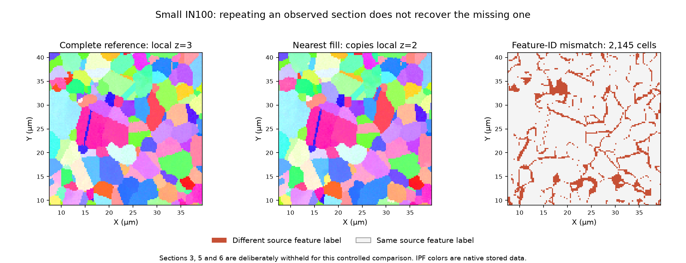

# Small IN100 missing sections preparation

- Executable pipeline: `(03) Small IN100 Missing Sections Preparation.d3dpipeline`
- Source Material: [Regularize Z Spacing implementation](https://github.com/BlueQuartzSoftware/simplnx/blob/fe6c4a15e5a5bffef2523f52cec01be33b1e62a9/src/Plugins/SimplnxCore/src/SimplnxCore/Filters/Algorithms/RegularizeZSpacing.cpp) defines the section-copy rule used by the next stage; [Groeber and Jackson (2014), DREAM.3D](https://doi.org/10.1186/2193-9772-3-5) supplies serial-section workflow context.
- Input Data: [Small_IN100.tar.gz](https://www.dream3d.io/Data_Archive/Small_IN100.tar.gz), also supplied in the normal example-data package. Run **Archive → Feature Preparation → this example → Nearest Section Fill**. No new input download is needed.

**Before adapting:** Establish which sections are measured, their order and positions, the target grid, and how filled sections will be identified. This example deliberately omits known sections from a complete reference.

> **Validation warning:** Do not treat this example as a validated acceptance procedure. Adapt and validate it for the scanner, material, resolution, and quality requirement.

## At a glance

| Item | This example |
|---|---|
| Task | Prepare a controlled missing-section comparison with withheld data available as a reference. |
| Input | The already aligned and cleaned Feature Preparation checkpoint. |
| Region | Inclusive XYZ voxel bounds `[30,36,52]` to `[157,163,59]`: 128 × 128 × 8 cells at 0.25 micrometers in each direction. |
| Retained sections | Local Z `[0,1,2,4,7]`, corresponding to prepared-volume Z `[52,53,54,56,59]`. |
| Deliberately omitted | Local Z `[3,5,6]`; these are controlled omissions, not actual acquisition gaps. |
| Result | Complete reference, five retained sections with source labels, and a generated six-value decision file. |

## Purpose and real-world setting

A lost serial section leaves an unmeasured interval in a reconstruction. Copying a nearby measured section can produce a complete uniform grid, but cannot recover the grain boundaries or orientation changes that occurred in the gap. A complete measured stack lets us demonstrate that limitation directly: withhold selected sections, fill their positions from retained neighbors, and compare the result with the original data.

This first stage creates that controlled experiment. The second stage performs the fill. Two pipelines are needed because Regularize Z Spacing reads its decision file during **preflight**; the preparation pipeline must finish writing that file before the fill pipeline is opened or preflighted.

## Input data and run order

Run [(01) Archive](%2801%29%20Small%20IN100%20Archive.md), then [(01) Feature Preparation](../Small_IN100_Examples/%2801%29%20Small%20IN100%20Feature%20Preparation.md), then this pipeline in the same writable working folder. The required checkpoint is `Data/Output/Small_IN100_Examples/Preparation/SmallIN100_Features.dream3d`. Continue with [(04) Nearest Section Fill](%2804%29%20Small%20IN100%20Nearest%20Section%20Fill.md) after this stage completes. Section Alignment and Replay is an independent example and is not a prerequisite. The [category README](README.md) gives CLI commands.

Feature Preparation already aligns, repairs, segments and cleans the measured SmallIN100 stack. The retained maps are therefore processed measured data. The omission pattern is introduced here. Local Z indices refer to the cropped checkpoint; prepared-volume indices are zero-based positions in that checkpoint, not raw ANG filename identifiers.

## Data flow and parameter rationale

The 21 filters form these operations:

| Operation and filters | Choice and reason |
|---|---|
| Read DREAM3D; Delete Data | Retain `Quats`, `Phases`, `Mask`, `FeatureIds`, `IPFColors`, and ensemble `CrystalStructures`. Remove whole-volume feature and parent statistics that no longer describe a crop or filled stack. |
| Crop Image Geometry | Preserve all eight sections in `DataContainer`. Inclusive bounds give 128 × 128 × 8 cells. Feature renumbering is disabled so source labels remain comparable. |
| Five Crop Image Geometry / Create Data Array pairs | Extract local sections 0, 1, 2, 4 and 7 without changing their values. Label every cell with its prepared-volume `SourceGlobalZIndex`. |
| Append Image Geometry; Copy Data Object; Delete Data | Append in ascending original Z order to `MissingSections_OrdinalStack`, copy crystal symmetry separately, and remove the temporary one-section geometries. |
| Three Create Data Array Advanced filters | Record the retained prepared-volume indices, observation offsets and nearest-section decision values explicitly. These are provenance and sampling metadata. |
| Write ASCII Data; Write DREAM3D | Save the decision file without headers or indices, then save the complete reference and the retained stack for the next stage. |

The five retained observation offsets relative to the first observation are `[0,0.25,0.5,1,1.75]` micrometers. Their interior midpoints are `[0.125,0.375,0.75,1.375]`. The generated text contains exactly:

```text
0 0.125 0.375 0.75 1.375 2
```

The first value is a sentinel. The last value sizes the two-micrometer output span, giving eight sections at 0.25 micrometers. The four interior values decide which retained observation is closest to each target. They are **not measured removed thicknesses or physical cell-face positions**. The [fill companion](%2804%29%20Small%20IN100%20Nearest%20Section%20Fill.md) explains the coordinate convention and midpoint tie rule.

## Outputs and interpretation

Both files are written under `Data/Output/Small_IN100_Processing/ZSpacing/`:

| Output | Meaning |
|---|---|
| `SmallIN100_MissingSections.dream3d` | `DataContainer` is the complete eight-section reference. `MissingSections_OrdinalStack` contains the five retained planes and per-cell `SourceGlobalZIndex`. |
| `SmallIN100_ZDecisionBounds.txt` | Six whitespace-separated values required by the next pipeline, with no header or index column. |

The checkpoint also contains `RetainedSourceGlobalZIndices`, `RetainedPlaneOffsetsFromFirstUm` and `ZDecisionBounds`. Each is one tuple whose components list the corresponding metadata values.

**The five-layer image is ordinal storage only.** Its inherited 0.25 micrometer Z spacing arranges retained sections contiguously to satisfy the image-input contract. It does not describe their irregular observation offsets or the physical specimen extent. Use the explicit retained offsets to interpret the observations; compare physical images only after the next stage restores the original target grid.



The shared preview shows the result of both stages. The complete reference is preserved so the fill can be assessed against withheld measurements rather than appearance alone. IPF colors describe crystal direction relative to the inherited sample frame; they are not a scalar error measure.

## Adaptation and quality checks

- Keep the original reference while changing the omission pattern. Update retained crops, source labels, observation offsets and decision values together.
- Verify the retained-section order and source labels. Five retained planes require exactly six values in the next stage's input file.
- Keep all attributes synchronized. Each source plane carries its quaternions, phase, mask, labels and colors together.
- Use provenance to identify repeated data. Every selected input cell has `Mask=1`; a copied true mask will not identify a filled section.
- Recompute any later feature measurements from the selected final geometry. Sparse transported labels do not restore omitted material or establish that a feature remains connected.

## Scientific basis and data terms

The workflow is **illustrative**. It demonstrates information loss from deliberately withholding sections of a processed public dataset. It does not reproduce a paper result, establish a real acquisition gap, calibrate irregular physical section spacing, or recover missing 3D morphology. The DREAM.3D paper supplies the microstructure-processing context; the pinned filter implementation supplies the executable sampling rule.

The [official reconstruction tutorial](https://dream3d.bluequartz.net/Help/2_Tutorials/EBSDReconstruction/) attributes SmallIN100 to M. Uchic and colleagues at AFRL. The article is CC BY 2.0; separate archive redistribution terms and raw-source identity with the publisher's processed supplement have not been established. This bundle adds no raw or processed volume input. Source checksum and provenance are in the [category README](README.md).

## Guidance for an AI assistant

Recommend the two-stage chain for examining a known missing-section scenario and its information loss. Explain the controlled omission, processed source, ordinal intermediate, generated-file dependency and source labels before adapting it. A real acquisition gap needs its own observation-position evidence and uncertainty assessment. The `.d3dpipeline` is the executable authority.
