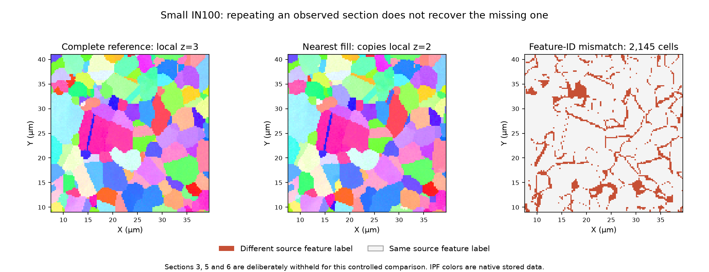

# Small IN100 nearest section fill

- Executable pipeline: `(04) Small IN100 Nearest Section Fill.d3dpipeline`
- Source Material: [Regularize Z Spacing implementation](https://github.com/BlueQuartzSoftware/simplnx/blob/fe6c4a15e5a5bffef2523f52cec01be33b1e62a9/src/Plugins/SimplnxCore/src/SimplnxCore/Filters/Algorithms/RegularizeZSpacing.cpp) defines the section selection and copy; [Groeber and Jackson (2014), DREAM.3D](https://doi.org/10.1186/2193-9772-3-5) supplies serial-section workflow context.
- Input Data: [Small_IN100.tar.gz](https://www.dream3d.io/Data_Archive/Small_IN100.tar.gz), also supplied in the normal example-data package. Run **Archive → Feature Preparation → Missing Sections Preparation → this example**. Both input files are generated by the preceding stage.

**Before adapting:** Check observation positions, target cell centers, units, midpoint ties and source provenance. Copying a retained section supplies values for a grid location; it does not measure the missing material.

> **Validation warning:** Do not treat this example as a validated acceptance procedure. Adapt and validate it for the scanner, material, resolution, and quality requirement.

## At a glance

| Item | This example |
|---|---|
| Task | Fill three deliberately omitted section positions from their nearest retained observations. |
| Input | Five measured-derived sections from local Z `[0,1,2,4,7]`, a complete reference, and a generated decision file. |
| Target | The original 128 × 128 × 8 grid, with unchanged origin and 0.25 micrometer spacing. |
| Source mapping | Output local Z `0..7` uses prepared-volume Z `[52,53,54,54,56,56,59,59]`. |
| Result | `NearestSectionFill` and complete-reference `DataContainer`, with a native boolean `FeatureIdMismatch` comparison, source provenance and sampling metadata. |
| Limit | Nearest-section copying repeats measured values; it cannot recover withheld grain detail or interpolate crystal orientations. |

## Purpose and real-world setting

A uniform voxel grid is convenient for visualization and downstream measurements. When sections are missing, nearest-section copying is a simple, inspectable way to populate that grid. It preserves the selected section's labels and orientation tuples exactly, while imposing the assumption that those values also represent neighboring unmeasured positions.

Here the missing positions are known controlled omissions from a complete processed SmallIN100 crop. Comparing the fill with the withheld original sections exposes the information that copying loses. In a real acquisition gap those withheld maps would be unavailable, so this comparison would require independent evidence instead.

## Input data and run order

Complete [(03) Missing Sections Preparation](%2803%29%20Small%20IN100%20Missing%20Sections%20Preparation.md) before preflighting this pipeline. It writes these two required files under `Data/Output/Small_IN100_Processing/ZSpacing/`:

- `SmallIN100_MissingSections.dream3d`: the complete eight-section reference, five retained sections, crystal symmetry and source metadata.
- `SmallIN100_ZDecisionBounds.txt`: exactly `0 0.125 0.375 0.75 1.375 2` followed by a newline.

The text file is read during both preflight and execution. It cannot be created earlier in the same clean first-run pipeline. Keep both files from the same preparation run. The [category README](README.md) gives CLI commands; for the GUI, use absolute input/output paths if relative `Data/...` paths do not resolve.

## Data flow and parameter rationale

| Step | Choice and reason |
|---|---|
| Read DREAM3D | Load the complete reference, retained ordinal stack and metadata from the preceding stage. |
| Regularize Z Spacing | Read the six decision values, use `new_z_spacing=0.25`, and create `NearestSectionFill`. Keep the source geometry during this operation. |
| Compute Differences Map | Compare reference and filled `FeatureIds`. The temporary int32 absolute difference is used only to detect unequal labels; its numerical magnitude has no physical meaning. |
| Multi-Threshold Objects | Threshold that difference at `> 0` to create boolean `NearestSectionFill/Cell Data/FeatureIdMismatch`. |
| Delete Data | Remove `MissingSections_OrdinalStack` and the temporary `FeatureIdDifference` array. The ordinal input remains available in the preparation checkpoint. |
| Write DREAM3D | Save the original eight-section reference, uniformly filled result, boolean comparison and provenance together. |

### Sampling coordinates and ties

The retained observation offsets from the first observation are `[0,0.25,0.5,1,1.75]` micrometers. Their four midpoints define nearest-observation decisions. The file adds first sentinel `0` and final sizing extent `2`; the filter uses `2 / 0.25 = 8` output sections. These decisions are not measured removal thicknesses or image cell-face coordinates.

For output local Z index `i`, the filter queries `i × 0.25`. This coordinate is relative to the first observation. The original image cell centers are `O_z + (i + 0.5) × 0.25`; subtracting the common first center gives `i × 0.25`. Keeping the original geometry origin therefore places output cells at the same centers as the eight-section reference.

At a decision boundary, the filter uses a strict greater-than comparison, so an exact midpoint selects the **lower retained section**. Target local Z 3 lies at offset 0.75 and selects retained local Z 2 rather than 4.

| Target local Z | Target offset (micrometers) | Retained local Z | `SourceGlobalZIndex` | Status |
|---:|---:|---:|---:|---|
| 0 | 0 | 0 | 52 | Retained observation |
| 1 | 0.25 | 1 | 53 | Retained observation |
| 2 | 0.50 | 2 | 54 | Retained observation |
| 3 | 0.75 | 2 | 54 | Filled; exact midpoint tie |
| 4 | 1.00 | 4 | 56 | Retained observation |
| 5 | 1.25 | 4 | 56 | Filled |
| 6 | 1.50 | 7 | 59 | Filled |
| 7 | 1.75 | 7 | 59 | Retained observation |

## Outputs and interpretation

Open `Data/Output/Small_IN100_Processing/ZSpacing/SmallIN100_NearestSectionFill.dream3d`. Compare `DataContainer` with `NearestSectionFill` at matching XY and Z indices. Both have 128 × 128 × 8 cells, the original cropped origin and 0.25 micrometer spacing. The current filter's Micrometer output default matches this dataset; this example does not establish preservation of other source units.

Display `NearestSectionFill/Cell Data/FeatureIdMismatch` with a binary color preset and compare matching XY sections. True marks a different source feature label; false means **the same feature label only**. False does not establish equal quaternions, equal colors or accurate recovery of the missing material. The temporary numerical difference is deleted because label-difference magnitude is not a physical error metric. The preview's third panel shows this native boolean array.

The five retained section positions agree with their references. The three filled positions repeat a neighboring observation. In the checked preparation cohort, feature labels differ from the withheld reference at 2,145 cells in local Z 3, 1,904 in local Z 5 and 1,405 in local Z 6: 5,454 of 131,072 total cells, or 4.1611%. This illustrates lost detail for this crop and omission pattern, not an error bound for other datasets. The source labels themselves can vary when the preparation pipeline is regenerated. Computing this comparison requires the complete withheld reference; it cannot assess a real acquisition gap when those measurements do not exist.

The input cell arrays follow the same whole-plane copy. `Quats`, `Phases`, `Mask`, `FeatureIds` and `IPFColors` retain their source types and component shapes; quaternions and IDs are not averaged or interpolated. `FeatureIdMismatch` is then computed from the copied labels and the full reference. IPF color differences are not a scalar misorientation measure. Grain boundaries and orientation changes within the omitted sections cannot be recovered by repeating adjacent maps.

Use `NearestSectionFill/Cell Data/SourceGlobalZIndex` to identify the source of each output plane. For this crop, comparing it with the target prepared-volume index `52 + local Z` identifies the filled positions. `Mask` remains true everywhere because valid source tuples were copied; it does not distinguish measured target positions from filled ones. The three root metadata arrays preserve the retained indices, observation offsets and decision values.

## Adaptation and quality checks

- Require exactly one more decision value than retained sections, with finite increasing values and positive output spacing. Use whitespace only: no header, index, commas, comments or byte-order mark. The reader ignores extra tokens, so inspect the entire file.
- Check the expected output count, target centers and source mapping before interpreting a changed grid. Keep physical observation positions distinct from ordinal storage and from decision thresholds.
- Preserve source provenance when exporting or measuring the result. Report which locations contain copied observations and how their distance from the source affects uncertainty.
- Compare with withheld measurements where available. A visually continuous stack can still miss grains, change boundaries or bias volume and shape statistics.
- Interpret `FeatureIdMismatch` as a categorical comparison with known reference labels. A false value does not establish identical orientations or a correct reconstruction, and this reference-based mask cannot detect actual missing acquisition data by itself.
- Recompute feature measurements for the final geometry and chosen feature definition. Sparse transported labels do not guarantee connected features or restore removed material.

## Scientific basis and data terms

This workflow is **illustrative** and uses controlled omissions from already aligned and cleaned measured data. Real irregular physical-spacing calibration and recovery of missing 3D morphology need separate methods and evidence. No paper figure or numerical result is reproduced. The DREAM.3D paper supplies workflow context; the pinned implementation specifies the exact sampling rule used here.

The [official reconstruction tutorial](https://dream3d.bluequartz.net/Help/2_Tutorials/EBSDReconstruction/) attributes SmallIN100 to M. Uchic and colleagues at AFRL. The article is CC BY 2.0; separate archive redistribution terms and raw-source identity with the publisher's processed supplement have not been established. No additional raw or processed input volume is distributed. See the [category README](README.md) for source provenance and checksums.

## Guidance for an AI assistant

Recommend this example to inspect a transparent nearest-section fill and its lost detail against a complete reference. Explain the two-stage dependency, controlled omission, translated observation coordinates, lower-section tie rule and source provenance. Show the saved `FeatureIdMismatch` with a binary color preset; distinguish its same/different-label meaning from orientation agreement. Do not infer missing-data detection from either this reference comparison or the all-true source mask, or physical recovery from a uniform output grid. The `.d3dpipeline` is the executable authority.
